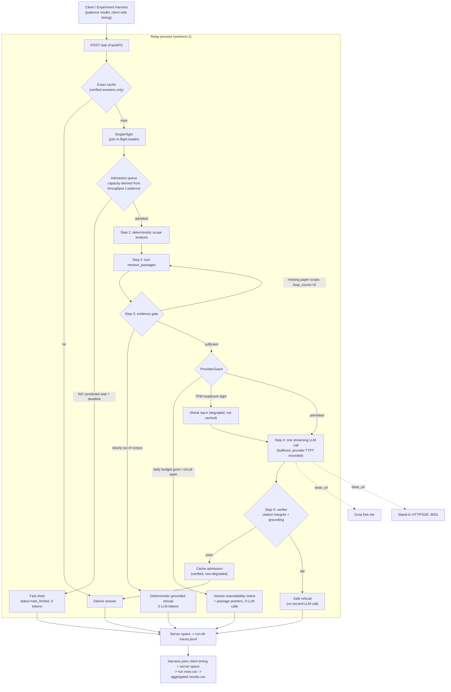

# ARCHITECTURE.md — The Relay System Architecture

> **Version:** v2 (Phase 00B reconciliation, 2026-11-11)
> **Status:** `APPROVED BASELINE (owner, 2026-11-11, at P01 start)` — items still tagged **[PROPOSED]**, **[OPEN]** or **[TO MEASURE]** remain explicitly unresolved.
> **Primary Authority:** `ASSIGNMENT.md`
> **Deployment Model:** One Relay application process (`uvicorn --workers 1`) + one separate local Stand-In process (`127.0.0.1:8001`) for simulated runs.
>
> **How to read decision status in this document:**
> - **[OWNER-DECIDED]** — decided by the project owner in the Phase 00B instructions. Binding unless the owner changes it.
> - **[PROPOSED]** — engineering proposal; not final until the owner approves it. Open items are collected in §16.
> - **[TO MEASURE]** — a value that must come from a real measurement, never from assumption.
>
> No number in this document is a measurement. Groq limits, latencies and throughput are unknown until the Phase 02-LIVE probes run.

---

## 1. Objectives and Priority Ordering

The Relay answers engineering questions only from three exact-version arXiv papers (`1706.03762v7`, `2410.00037v1`, `2507.07955v2`) under real Groq free-tier limits, bursty traffic, slow or failing calls, and impatient users.

The brief says the four goals (fast, good, cheap, nobody turned away) cannot all be met. Our explicit ordering:

1. **Never deliver an unverified answer.** Citation integrity and grounding beat speed. *(Cost: user-visible first token arrives only after the full answer is generated and verified — §7.)*
2. **Spend scarce quota only where it changes the answer.** Exactly one LLM call per uncached request; everything else is deterministic and local. Identical concurrent questions share one call. *(Cost: no LLM-based query rewriting or self-repair.)*
3. **Fail fast and honestly rather than queue hopelessly.** Requests that cannot be served within the client's patience are shed immediately with zero tokens spent. *(Cost: some users are turned away under load.)*
4. **Everything is recomputable.** Every table figure is computable from the canonical `results.csv` and the raw evidence directories.

---

## 2. Deployment and Concurrency Scope **[OWNER-DECIDED]**

- **One application worker** (`uvicorn --workers 1`). All admission, quota, cache and SingleFlight state lives in one process's memory.
- **One separate Stand-In process** on `127.0.0.1:8001`, reached over real HTTP/SSE through the same provider client used for Groq.

**Documented limitations of in-memory state (accepted, not mitigated):**
- **SingleFlight** only coalesces requests that reach the *same* process. With `workers > 1` or multiple hosts, identical concurrent questions would each trigger a provider call, multiplying quota use exactly during bursts — the case it exists for.
- **Quota tracking** (`ProviderGuard`) would be duplicated per worker; each would believe it owns the full RPM/TPM budget, producing unexpected 429s.
- **The exact cache** is per-process and lost on restart. A restart during a burst means a cold cache.
- **No crash recovery:** in-flight requests are lost if the process dies.

Fixing these would need shared external state (e.g. Redis), which is out of scope (§14).

---

## 3. Technology Stack

| Layer | Choice | Why | Status |
| :--- | :--- | :--- | :--- |
| Language | Python 3.11+ (developed on a uv-managed 3.12 venv) | Mature PDF/embedding/HTTP ecosystem; fast to build | [PROPOSED] venv version |
| Web / HTTP | FastAPI + Uvicorn + `httpx.AsyncClient` | Native asyncio cancellation, SSE, one transport for Groq and Stand-In | [PROPOSED] |
| PDF parsing | `pymupdf` | Block bounding boxes allow 2-column ordering; no PyTorch | [PROPOSED] |
| Embeddings / rerank | `fastembed` (ONNX): `BAAI/bge-small-en-v1.5`, `Xenova/ms-marco-MiniLM-L-6-v2` | No PyTorch, zero API tokens. Models download from Hugging Face once (Phase 04 needs network once); unit tests inject fakes | [PROPOSED] |
| Search | Exact NumPy cosine + `rank-bm25`, fused with RRF | Corpus is ~1k chunks; exact search is sub-millisecond, no ANN error | [PROPOSED] |
| Validation | Pydantic v2 (+ `pydantic-settings`) | Strict contracts at module boundaries | [PROPOSED] |
| Token accounting | **Provider-reported `usage`** (authoritative) + a conservative character-based estimate for pre-call reservation | See §9.3. No tokenizer is assumed to match the provider's | [OWNER-DECIDED] principle |
| Cache | **In-memory exact cache** per process, cleared per experiment run | Smallest thing that meets the need; no SQLite/DB | [PROPOSED] (replaces SQLite) |
| LLM | Groq free tier; `openai/gpt-oss-20b` is an **initial candidate only** | Final model chosen from the comparison in §10 | [OWNER-DECIDED] |
| Frameworks | None (no LangChain/LlamaIndex/LangGraph) | Full visibility of headers, retries, tokens | [PROPOSED] |

`tiktoken` is removed from the stack: its encodings are not verified to match Groq models' tokenizers and it downloads encoding files at first use, which conflicts with offline tests. Chunk sizes are defined in whitespace-delimited words (§6); token cost is reported from provider usage.

---

## 4. High-Level Architecture



---

## 5. Request Sequence

```mermaid
sequenceDiagram
    autonumber
    actor H as Harness (client)
    participant In as Ingress + Cache + SingleFlight
    participant Q as Admission Queue
    participant P as Pipeline (scope, tool, gate)
    participant G as ProviderGuard
    participant L as Groq / Stand-In
    participant V as Verifier

    H->>In: POST /ask {request_id, question, retrieval_setting, deadline_ms}
    Note over H: client starts its clock; samples patience
    alt exact cache hit
        In-->>H: verified answer (cache_status=exact_hit, 0 tokens)
    else identical request already in flight
        In-->>H: follower receives leader's result (cache_status=coalesced, 0 tokens)
    else miss, leader
        In->>Q: enqueue (record queue_depth_at_entry)
        alt queue full or predicted wait > remaining deadline
            Q-->>H: shed (rate_limited)
        else admitted
            Q->>Q: drop if deadline expired or client disconnected
            Q->>P: scope -> retrieve_passages -> evidence gate (max 1 re-query)
            alt clearly out of corpus
                P-->>H: deterministic refusal (0 LLM tokens)
            else sufficient
                P->>G: request permission (daily, TPM reservation, semaphore, circuit)
                alt daily budget gone or circuit open
                    G-->>H: honest unavailability + passage pointers
                else permitted
                    loop retryable failure, within retry budget and deadline
                        G->>L: chat/completions stream=true, include_usage
                        L-->>G: SSE deltas (provider_first_token_ms) + usage + headers
                    end
                    G->>G: settle reservation with actual usage; sync headers
                    G->>V: complete buffered answer
                    alt verified
                        V-->>H: deliver answer (user first byte = first_token_ms)
                    else failed
                        V-->>H: safe refusal (error_code=citation_verification_failed)
                    end
                end
            end
        end
    end
    Note over H: client gives up at patience -> disconnect -> status=timeout, error_code=client_gave_up
```

---

## 6. Pipeline Steps (deterministic vs LLM)

| Step | Mechanism | Mode | Assignment requirement satisfied |
| :--- | :--- | :--- | :--- |
| 0 — Cache + SingleFlight | Normalised exact key; in-flight future map | Deterministic | Burst absorption |
| 1 — Scope analysis | Lexicon/regex: paper cues (`Attention`/`Transformer`, `Moshi`/`Mimi`/`Helium`, `H-Net`/`dynamic chunking`), comparison intent, technical identifiers | Deterministic | Step 1 |
| 2 — `retrieve_passages` tool | Pydantic-validated args, timeout, timing; dense + BM25 + RRF, optional rerank, optional paper filter | Deterministic **tool call** | Step 2, tool call, retrieval |
| 3 — Evidence gate | `SUFFICIENT` / `LOOP_EXPAND` (paper-scoped re-query, **max 1**) / `EARLY_REFUSAL` (only clearly out-of-corpus) | Deterministic **branch + bounded loop** | Step 3, branch/loop |
| 4 — Grounded synthesis | One streaming LLM call; prompt lists passages `[P1]..[Pk]` with paper/page/section; instructs cite-or-refuse (`INSUFFICIENT_EVIDENCE`) | **The only LLM call** | Step 4 |
| 5 — Verification | Citation integrity + grounding constraints (§7.3) | Deterministic | Step 5 |

**Tools [OWNER-DECIDED: avoid unnecessary second tools]:** only `retrieve_passages` is implemented. The earlier `fetch_section_context` tool is removed. The bounded re-query loop reuses `retrieve_passages` with a paper filter.

**Retrieval presets [PROPOSED, sizes in words]:** `small_fast` (~180-word pieces, top-4, no rerank), `balanced_rerank` (~330-word pieces, fetch 12 → rerank → top-4), `large_wide` (~600-word pieces, top-6, no rerank). Final values are set in Phase 04 after inspecting extracted text. Reference/bibliography chunks are down-weighted unless the question asks about references.

**Known limitation:** the evidence gate can only catch clearly off-topic questions. Near-topic unanswerable questions (the brief promises these) must be refused by the LLM's cite-or-refuse instruction and are then checked by the verifier.

---

## 7. Answer Verification and Delivery **[OWNER-DECIDED]**

### 7.1 Policy
1. The upstream call streams (`stream=True`, `stream_options.include_usage=True`) so the Relay can measure provider TTFT, detect stalled streams, and cancel on disconnect.
2. The Relay **buffers the complete answer**, runs the verifier, and **only then** delivers it to the client.
3. If verification fails, the client receives a **safe refusal** (an honest "I could not produce a verifiable answer from the papers" message). **No repair loop and no second LLM call.**
4. Verified cache hits and deterministic refusals are delivered immediately.

### 7.2 Two TTFT metrics (recorded separately)
- `provider_first_token_ms` — from server request arrival to the first visible **content** delta received from the provider (reasoning deltas excluded; first reasoning delta recorded in traces).
- `first_token_ms` — **user-visible**: measured by the harness (client side) from sending the request to receiving the first byte of the delivered answer. Blank when nothing was delivered.

On uncached live answers `first_token_ms ≈ total_ms` by design. The gap between the two metrics is the measured cost of verification-before-delivery and will be reported.

### 7.3 What the verifier checks (and does not)
Rejects an answer when any of these hold:
- (a) A non-refusal answer has no `[Pi]` tag, or **any sentence making a factual claim lacks an appropriate citation**. **[OWNER-DECIDED: every factual sentence must carry a citation]**
- (b) A tag references a passage that was not supplied.
- (c) A paper name, arXiv ID or page mentioned in the sentence contradicts the cited passage's metadata.
- (d) **Grounding constraint:** a number or technical identifier (e.g. `d_model`, `12.5 Hz`) in a sentence does not appear in any passage cited by that sentence.
- (e) A refusal (`INSUFFICIENT_EVIDENCE`) also contains factual claims.

It does **not** prove semantic entailment. A wrong claim attached to a valid citation can pass; this is measured by owner grading (§11) and stated in the write-up.

---

## 8. Cache and SingleFlight **[OWNER-DECIDED]**

- **SingleFlight:** keyed by `(normalised_question, retrieval_setting)`. The leader's work runs as a detached task; followers await it. A follower that disconnects simply stops waiting; the leader task is cancelled only when **no** waiters remain. Followers record `cache_status=coalesced`, `provider_called=false`, `tokens_in=tokens_out=0` so token sums stay exact.
- **Exact cache:** in-memory, keyed by normalised question hash scoped by `(corpus_sha256, retrieval_setting, prompt_version, model_id)`. Admits only answers that are verified (or verified refusals) **and** not degraded. Cleared at the start of every experiment run so runs cannot contaminate each other.
- **Semantic cache: deliberately excluded** (§14). Reason: a near-duplicate match for a different question (e.g. `d_model` vs `d_ff`, Moshi vs Transformer) would deliver a confidently wrong cited answer — the failure the brief forbids — and calibrating it safely costs more time than it saves.
- **Experiment isolation:** cache is `off` in all retrieval-quality runs. Load scenarios declare their cache mode in the run manifest; cache-on vs cache-off comparisons are separate, labelled runs.

---

## 9. Groq Integration and Quota Control

### 9.1 Header semantics — must be verified, not assumed **[OWNER-DECIDED]**
The Phase 00 web check reported the following documented meanings. **They are treated as hypotheses until verified empirically in Phase 02-LIVE.**

| Header | Documented meaning (to verify) | Empirical verification method |
| :--- | :--- | :--- |
| `x-ratelimit-limit-requests` | Requests per **day** (RPD) — **not RPM** | Value matches console RPD for the model |
| `x-ratelimit-remaining-requests` | Remaining RPD | Decrements by 1 per call across consecutive calls |
| `x-ratelimit-reset-requests` | Time until RPD window replenishes | Hours/minutes-scale duration, not seconds-scale |
| `x-ratelimit-limit-tokens` | Tokens per **minute** (TPM) | Value matches console TPM |
| `x-ratelimit-remaining-tokens` | Remaining TPM | Drops by roughly the call's `usage.total_tokens` |
| `x-ratelimit-reset-tokens` | Time until TPM replenishes | Seconds-scale duration |
| `retry-after` | Seconds to wait; on `429` only | Observed only if an owner-approved limit probe runs |

RPM and TPD are not expected in headers; they come from the Groq console/docs and, if the owner approves a minute-limit probe, from the `429` body. Every raw header seen is stored in the probe evidence so any misreading can be re-checked. If a header behaves differently from the table, the parser and this table are corrected (via the §7 protocol in `CLAUDE.md`).

### 9.2 Responsibilities
- **Admission queue (application layer):** queue depth, deadlines, disconnect checks, predictive shedding. No provider-header logic.
- **ProviderGuard (sole quota owner):** concurrency semaphore; local sliding-window RPM and TPM; RPD/TPM state synced from headers; local TPD counter; daily safety stop; retry policy + retry budget; minimal circuit breaker. No other module keeps rate-limit state.
- **Provider client:** plain `httpx.AsyncClient` with **no hidden retries** (no retry wrapper; transport `retries=0`). All retries are visible and counted by ProviderGuard.

### 9.3 Token reservation and reconciliation **[OWNER-DECIDED principle]**
- Before a call, ProviderGuard reserves `estimate = ceil(prompt_chars / chars_per_token) + max_tokens`, where `chars_per_token` starts conservative (low, so the estimate is high) and is **updated from observed `usage.prompt_tokens / prompt_chars`** ratios.
- After the call, the reservation is **settled to the provider-reported `usage`** (prompt + completion, including reasoning tokens).
- If a stream ends without a usage chunk (cancel, stall, error), the reservation stays charged and the row records `usage_source=estimated`.
- Header-reported remaining TPM, when present, overrides the local estimate.

### 9.4 Daily quota protection **[OWNER-DECIDED]**
- The daily quota is never deliberately exhausted for testing.
- ProviderGuard and every real-run script stop at a configurable **daily safety fraction** of known RPD/TPD (proposed default 0.75 [PROPOSED]) and every script has a hard `--max-real-calls` cap.
- The "daily budget exhausted" scenario runs against the Stand-In (and the guard's simulated exhausted state), never by draining the real account.

### 9.5 Retries
Full-jitter exponential backoff honouring `retry-after`; no retry when the wait exceeds the remaining deadline share, on daily exhaustion, or on non-retryable errors (400/401/403/413). A rolling **retry budget** caps retries relative to first attempts and can be disabled for the retry-amplification experiment (heading 6). Because answers are buffered, a retry after a partial stream discards the partial buffer — nothing unverified was delivered.

---

## 10. Model Selection **[OWNER-DECIDED: candidate, not final]**

1. **Discover** the models enabled on the owner's account with `GET /openai/v1/models` (Phase 02-LIVE).
2. **Shortlist** at most 3 candidates (e.g. `openai/gpt-oss-20b` plus one non-reasoning model and one larger model, subject to what is listed) using console-listed free-tier limits.
3. **Latency baseline (Day 1):** a few short calls per candidate within the Day 1 cap.
4. **Quality mini-comparison (Day 2):** ~6 owner-written questions × candidates on `balanced_rerank`, cache off. Compare correct-and-cited rate, refusal behaviour, tokens per answer (including reasoning tokens), provider TTFT, and how many answers per day the TPD would allow.
5. **The owner selects** the model; the choice and its evidence are recorded in the log and report. Reasoning settings (`reasoning_effort`/`reasoning_format`) are configurable and recorded per run.

---

## 11. Evaluation Questions and Grading **[OWNER-DECIDED: owner authors questions]**

- **Authorship:** the owner writes ≥15 (target 18) questions. Claude prepares the schema, template, validator and grading tooling, and later **verifies** each question's expected answer and paper/page references against the extracted PDFs, reporting discrepancies without silently editing the owner's content.
- **Question schema (`eval/questions.json`):** `id`, `author`, `category`, `question`, `answerable`, `expected_answer`, `required_facts[]`, `gold_citations[] {paper_id, page, section, quote}`, `forbidden_claims[]`, `trap_type` (nullable), `notes`.
- **Coverage target [PROPOSED]:** direct factual; multi-hop/cross-section; numeric/technical detail; cross-paper/ambiguous; **≥3 unanswerable**; **≥3 retriever traps** that cover the three naive-retriever failure modes for the write-up. Candidate failure modes: bibliography chunks matching keywords; shared vocabulary across papers ("Transformer", "attention", "chunk"); numbers in tables or equations split or garbled by extraction; answers leaking from other versions of a paper.
- **Grade labels:** exactly `correct`, `wrong`, `refused_correctly`, `refused_wrongly`, or blank when no answer was delivered or the row is ungraded (load/stand-in rows). No other values.
- **Rules:**
  - answerable + answer: `correct` only if all `required_facts` are present, ≥1 citation resolves to a gold page, and no `forbidden_claims`; otherwise `wrong` (a correct fact with a wrong or missing citation is `wrong`).
  - answerable + refusal (including a verifier safe refusal): `refused_wrongly`.
  - unanswerable + refusal: `refused_correctly`; unanswerable + answer: `wrong`.
- **Process:** a deterministic first-pass rubric proposes a grade with reasons; **the owner reviews every graded row** and may override; overrides are stored with the run evidence and the final grade goes into the run rows. No LLM-as-judge.

---

## 12. Stand-In Service

- Separate FastAPI process exposing OpenAI-compatible `/openai/v1/chat/completions` and `/openai/v1/models`, plus `/admin/config`, `/admin/reset`, `/admin/stats`.
- Seeded behaviour: latency (TTFT and inter-token delay) fitted from Phase 02-LIVE probe evidence; slowdown above a concurrency knee; probabilistic 5xx; slow-success stragglers; stalled streams; RPM/TPM/RPD/TPD enforcement emitting `429`, `retry-after` and the same header names/meanings verified on Groq.
- Answers are extractive and cite supplied passages: they test orchestration, timing and citation plumbing, **not** answer quality. All answer-quality figures come from real Groq runs.
- If calibration evidence is missing, the profile is labelled `uncalibrated_defaults` and never presented as Groq-measured. Each calibration is stored as its own run directory (§13).

---

## 13. Raw Evidence, Run Directories and `results.csv` **[OWNER-DECIDED]**

### 13.1 Directory layout (tracked in Git — never gitignored)
```
evidence/
  groq_probes/<run_id>/          manifest.json, probes.jsonl (sanitised), summary.json
  standin_calibration/<run_id>/  manifest.json, profile.json, fit_report.json
  experiments/<run_id>/          manifest.json, rows.csv, traces.jsonl, grades.json (if graded), answers_audit.json
  canonical_runs.json            the owner-selected runs that make up results.csv
results.csv                      canonical, aggregated (repository root)
scratch/                         gitignored: smoke runs, temporary output
```
- `run_id` format [PROPOSED]: `<kind>-<YYYYMMDDTHHMMSSZ>-<shortsha>` (e.g. `exp-20261112T101500Z-6ffab47`).
- Every `manifest.json` records: run_id, kind, scenario(s), source (real/stand-in), model_id, reasoning settings, retrieval setting(s), cache mode, seed, config snapshot (no secrets), git commit, start/end time, real-call count, and status (`complete`/`aborted`).
- **Sanitisation:** no API keys, no `Authorization` headers; organisation/account identifiers inside Groq error bodies are redacted.

### 13.2 Single owner of `results.csv`
- Only the experiment harness's aggregation step (`scripts/build_results.py`) writes `results.csv`. The Relay server never writes it; it writes server spans to the run directory's `traces.jsonl`.
- Aggregation reads only the runs listed in `evidence/canonical_runs.json`, joins client rows with server spans by `request_id`, validates every row, and **fails loudly on duplicate `request_id`s** (request IDs are prefixed by run_id, so re-running creates new IDs rather than duplicates; selecting the same run twice is rejected).
- **[OWNER-DECIDED] Probe rows:** actual Groq inference probes are recorded in `results.csv` with `scenario=probe_*`, `source=real`, `retrieval_setting=none` and a blank `answer_grade`. Detailed probe data (raw headers, bodies) stays in the probe run's `traces.jsonl`. Calls that are not inference (e.g. `GET /models`) produce no rows. Enforced by `ResultRow` validation.
- **Client/server join (P01 implementation note):** `rows.csv` in a run directory holds complete rows. The harness merges client timing with server spans when it writes each row (P10). Aggregation validates and combines complete rows; it does not perform the join itself.

### 13.3 Schema
**Columns 1–12 (exact names and order from `ASSIGNMENT.md`):** `request_id, scenario, source, start_time, first_token_ms, total_ms, status, retries, tokens_in, tokens_out, retrieval_setting, answer_grade`.

- `source`: `real` | `stand-in`. `start_time`: ISO-8601 UTC with ms. `first_token_ms`, `total_ms`: client-measured ms (`first_token_ms` blank if nothing delivered). `status`: `ok` | `rate_limited` | `timeout` | `error`. `tokens_in/out`: provider-reported sums across all attempts (estimate if no usage; see `usage_source`). `answer_grade`: §11 values or blank.

**Appended columns 13+ [PROPOSED list]:** `run_id`, `question_id`, `provider_first_token_ms`, `server_total_ms`, `queue_depth_at_entry`, `waiting_ms`, `working_ms`, `retrying_ms`, `retrieval_ms`, `cache_status` (`off`|`miss`|`exact_hit`|`coalesced`), `provider_called`, `degraded`, `model_id`, `usage_source` (`provider`|`estimated`|`none`), `cost_usd`, `verification_verdict` (`VERIFIED`|`REFUSAL_VERIFIED`|`BLOCKED`|`EARLY_REFUSAL`|`NOT_RUN`), `error_code`.

**Invariant:** `waiting_ms + working_ms + retrying_ms == server_total_ms` (±1 ms). `total_ms − server_total_ms` is client/transport overhead. Spans may be blank only if the server never received the request.

### 13.4 Outcome classification
| Situation | status | error_code | answer_grade |
| :--- | :--- | :--- | :--- |
| Verified answer delivered | ok | — | graded or blank |
| Exact cache hit / coalesced follower | ok | — | graded or blank |
| Deterministic early refusal | ok | — | graded or blank |
| Verification failed → safe refusal delivered | **ok** [OWNER-DECIDED] | `citation_verification_failed` | graded (answerable → `refused_wrongly`) |
| Queue full / predicted wait exceeds deadline | rate_limited | `queue_full` / `predicted_wait_exceeds_deadline` | blank |
| Upstream minute-limit 429 after retries | rate_limited | `upstream_rate_limited` | blank |
| Daily budget exhausted (guard) | rate_limited | `daily_budget_exhausted` | blank |
| Deadline expired before/while working | timeout | `deadline_expired` | blank |
| **Client gave up (abandonment)** | **timeout** | **`client_gave_up`** | blank |
| Provider stream stalled / read timeout | timeout | `provider_stalled` | blank |
| Upstream 5xx after retries / circuit open | error | `upstream_error` / `circuit_open` | blank |
| Provider rejected credentials (401/403) | error | `provider_auth_error` | blank |
| Request too large (413) | error | `payload_too_large` | blank |
| Unexpected internal failure | error | `internal_error` | blank |

Additional rules enforced by `ResultRow` (P01):
- `status=ok` ⇔ something was delivered, so `first_token_ms` is set. Non-`ok` rows have blank `first_token_ms` and `answer_grade`, and require an `error_code` valid for their status.
- `ok` rows carry no `error_code`, except `citation_verification_failed`, which must appear together with verdict `BLOCKED`.
- When the provider was not called: 0 tokens, 0 retries, `usage_source=none`, blank `provider_first_token_ms`. Exact-cache hits, coalesced followers and `EARLY_REFUSAL` rows imply the provider was not called.
- Adding an error code requires updating this table and `relay.schemas.ERROR_CODES_BY_STATUS` together.

`cost_usd` uses a pricing table snapshotted (with source URL and date) into the run manifest; if no documented price exists for a model, cost is reported as "not measured".

---

## 14. Scope: Mandatory, Deferred, Excluded

- **Mandatory:** everything needed for the brief's tables and headings — pipeline (≥4 steps, tool, branch/loop, retrieval), verification, real probes, stand-in, ≥5 load scenarios (steady, burst, sustained overload, per-minute limit halved, daily budget exhausted), ≥3 retrieval settings, owner-graded eval, recomputable tables.
- **Deliberately excluded (to be named in write-up heading 8):**
  - **Semantic cache** — false-match risk (wrong cited answers) and calibration cost.
  - **Multi-worker / multi-host scaling** — would need shared state for SingleFlight, quota and cache (§2).
- **Also not built:** LLM repair loop; second retrieval tool; LLM query rewriting; LLM-as-judge; SQLite/Redis/Postgres/Docker; web UI.

---

## 15. Admission Queue Sizing **[OWNER-DECIDED principle]**

Queue capacity is **derived, not assumed** (the earlier fixed `maxsize=16` is withdrawn):

- `service_rate` = sustainable completed answers per second, from measurement: on the real service, bounded by `min(RPM/60, TPM / (60 × tokens_per_answer))` using measured tokens per answer; on the Stand-In, from its configured limits and measured service times.
- `patience` = a client-patience distribution chosen by the owner [OPEN — §16] and used by the harness to abandon requests.
- `capacity = max(1, floor(service_rate × patience_quantile))`, using a patience quantile (proposed: median) so a queued request has a realistic chance of being served before its client gives up (Little's law).
- Predictive shedding additionally rejects a request when `queue_position / service_rate` exceeds its remaining deadline.

The derivation and the resulting numbers are recorded per run in the manifest and explained in the write-up.

---

## 16. Open Decisions Requiring Owner Approval

**Resolved by the owner on 2026-11-11 (P01 start):**
- ~~1. Formal approval~~ → v2 is the approved baseline; [PROPOSED]/[OPEN]/[TO MEASURE] items stay open.
- ~~2. Verifier safe refusal status~~ → `status=ok` + `error_code=citation_verification_failed`.
- ~~3. Probe rows in `results.csv`~~ → yes: `probe_*` scenarios, `retrieval_setting=none`, blank grade; detail in evidence files.
- ~~9. Verifier claim granularity~~ → every factual sentence must carry an appropriate citation.

**Still open:**

4. **Client-patience distribution** for the harness (proposal to be made in Phase 10 from what the brief implies; e.g. log-normal, median ~20 s — owner chooses).
5. **Daily safety fraction** default (proposed 0.75) and per-day real-call caps (`IMPLEMENTATION_PLAN.md` budget table).
6. **Minute-limit probe:** whether to deliberately trigger one real RPM/TPM `429` (requires separate explicit approval; never the daily limit).
7. **Final model** after the comparison in §10.
8. **Retrieval preset values** after Phase 04 text inspection.
10. **`deadline_ms` vs client patience:** real clients do not announce their patience. Proposal: the harness sends a fixed service-level `deadline_ms` (owner-chosen) and abandons privately at its sampled patience, so server-side shedding (`deadline_expired`, `predicted_wait_exceeds_deadline`) and client abandonment (`client_gave_up`) are measured separately.
