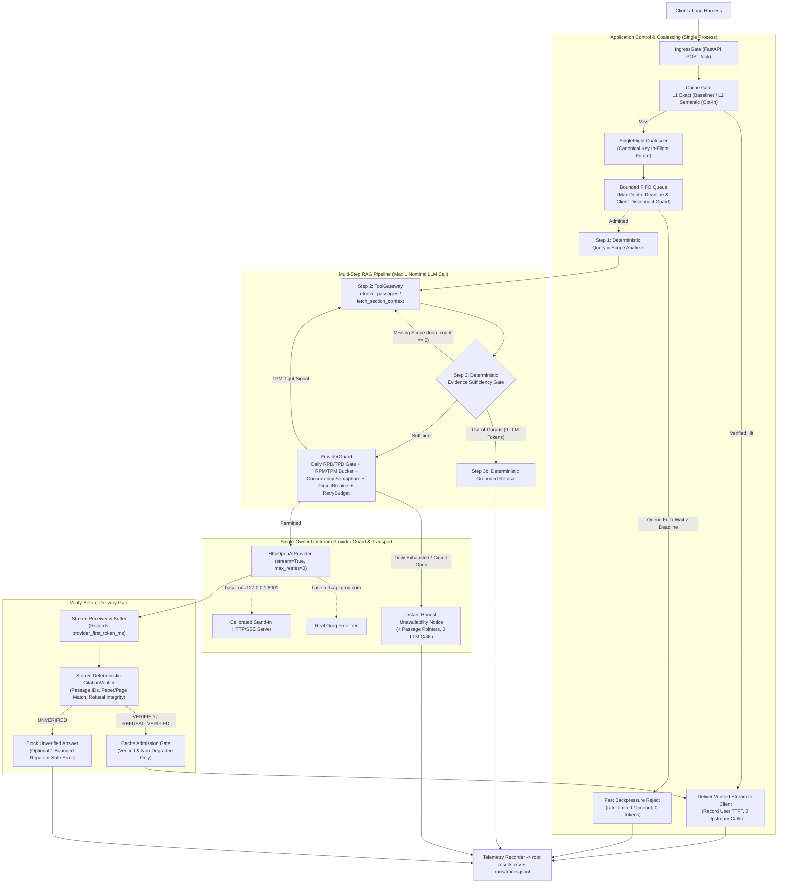
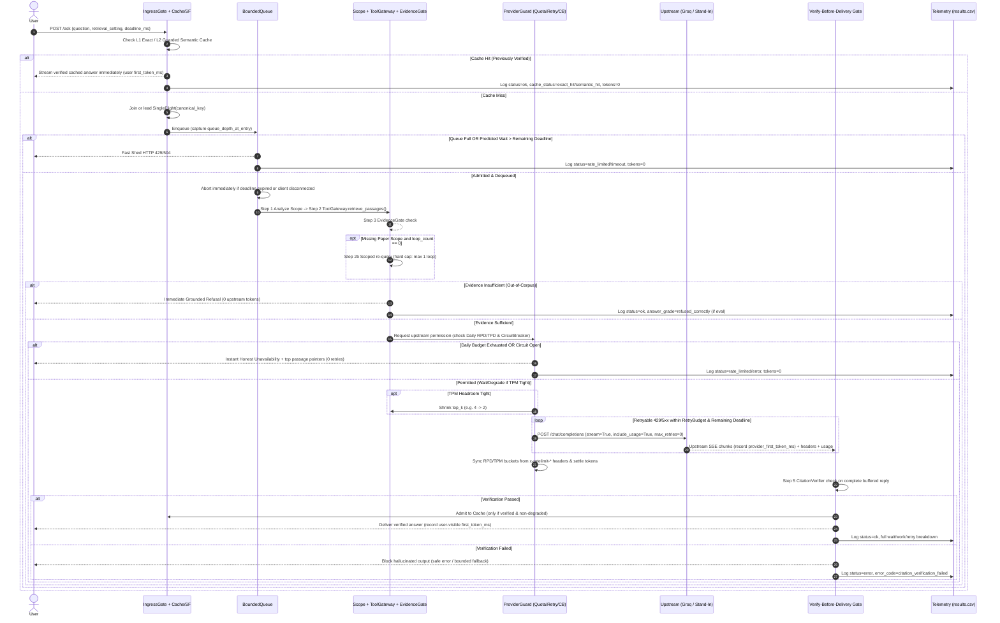

# ARCHITECTURE.md — The Relay System Architecture

> **Status:** `PROPOSED — AWAITING OWNER APPROVAL`  
> **Primary Authority:** `ASSIGNMENT.md`  
> **Deployment Model:** Single-Process Async Service (`uvicorn --workers 1`) + Separate Local Stand-In Process (`127.0.0.1:8001`)  
> **Note:** Nothing in this document is final until explicitly approved by the project owner.

---

## 1. System Objectives & Conflict Framing

**The Relay** answers engineering questions strictly from three exact-version arXiv papers (`1706.03762v7`, `2410.00037v1`, `2507.07955v2`). Production traffic arrives in correlated post-incident bursts against strict, shifting Groq free-tier limits (`RPM`, `TPM`, `RPD`, `TPD`), occasional slow tools/calls, and impatient users who abandon waiting requests.

Because no single architecture can simultaneously maximize speed, accuracy, zero cost, and zero rejections under finite quotas, this architecture enforces the explicit priority ordering required by `ASSIGNMENT.md`:

1. **Correctness & Citation Integrity (Non-Negotiable):** Never emit an uncited, hallucinated, or unverified answer just to preserve speed.
2. **Quota & Overload Survival (Graceful Degradation + Fast Shedding):** Absorb duplicate bursts via coalescing/caching, adapt retrieval size when TPM is tight, and fast-reject excess load cleanly rather than burning scarce RPD/TPM on doomed or abandoned requests.
3. **Observability & Recomputability:** Every latency span, token count, queue depth, retry, and verification verdict is traceable from `results.csv` and `runs/traces.jsonl`.

---

## 2. Deployment & Concurrency Assumptions (Explicit Scope)

**Chosen Runtime Topology:** **One Python 3.11+ `uvicorn` process (`workers=1`)** for The Relay API/pipeline, communicating over localhost HTTP/SSE with **one standalone local Stand-In `uvicorn` process** (`workers=1`, port `8001`) during simulation runs (or directly with `https://api.groq.com/openai/v1` during real Groq runs).

**Engineering Consequences of Single-Process Deployment:**
- **In-Memory SingleFlight:** Request coalescing (`asyncio.Future` map) works instantaneously in RAM across concurrent client connections with zero distributed lock overhead.
- **Single-Owner `ProviderGuard`:** In-memory sliding windows (`RPM`, `TPM`), daily counters (`RPD`, `TPD`), `asyncio.Semaphore`, and `CircuitBreaker` share exact consistent state across all coroutines without Redis.
- **In-Memory Hybrid Vector + BM25 Index:** All ~400–700 paper chunks fit in `< 2 MB` RAM with `< 0.1 ms` exact cosine search.
- **Scaling Limitation (Accepted):** Running `--workers > 1` or scaling across multiple hosts would fragment SingleFlight coalescing, duplicate RPM/TPM windows (causing unexpected 429s), and desynchronize in-memory L2 cache vectors unless external shared state (e.g., Redis) were introduced. Multi-worker scaling is deliberately deferred for this 3-day single-node assignment.

---

## 3. Technology Stack Selection & Alternatives

| Layer | Selected Technology | Alternatives Considered | Why Alternatives Rejected | Engineering Benefits & Limitations | Status |
| :--- | :--- | :--- | :--- | :--- | :--- |
| **Language** | Python 3.11+ | Go, C++ | Lack turnkey local ONNX embeddings/reranking + multi-column PDF layout tools in 3 days | Rapid development, rich scientific/HTTP ecosystem; CPU work offloaded via `asyncio.to_thread` to avoid stalling event loop | **Mandatory** |
| **Web / HTTP** | FastAPI + Uvicorn + `httpx.AsyncClient` | Sync Flask, gRPC, Celery | Sync Flask leaks threads on slow streams; Celery adds broker bloat; gRPC breaks simple SSE | Native `asyncio` cancellation, clean SSE parsing, shared HTTP transport for Groq & Stand-In | **Mandatory** |
| **PDF Parsing** | `pymupdf` (`fitz`) + `tiktoken` (`cl100k_base`) | `pypdf`, `pdfplumber`, `docling` | `pypdf` garbles 2-col `1706.03762v7`; `docling` drags GBs of PyTorch/OCR | Sub-second extraction, font-size heading detection, bounding-box column sorting | **Mandatory** |
| **Embeddings & Rerank** | `fastembed` (`BAAI/bge-small-en-v1.5` + `Xenova/ms-marco-MiniLM-L-6-v2`) | `sentence-transformers` (PyTorch), OpenAI/Groq embeddings | PyTorch adds ~2 GB overhead; remote embeddings burn quota/network | Lightweight ONNX Runtime (~130 MB), zero API token cost, releases GIL during C++ execution | **Mandatory** |
| **Search Index** | Exact L2-normalized NumPy cosine + `rank-bm25` (RRF) | FAISS, ChromaDB, Qdrant | External DBs or C++ ANN indices add Windows install friction & unnecessary complexity for <1k vectors | 100% exact recall, `< 0.5 ms` lookup, zero ANN approximation error; linear scan limits scale past ~100k chunks | **Mandatory** |
| **LLM (Groq)** | Active fast model verified in Phase 5 (candidate: `openai/gpt-oss-20b` or active non-reasoning model via `GROQ_MODEL`) | Multi-model router+drafter+critic chain | Multi-call chains multiply RPM/TPM consumption 3–4× against tight ~8k TPM free caps | 1 LLM call nominal path; reasoning control (`reasoning_format`/`reasoning_effort`) configurable so thinking doesn't starve TTFT | **Mandatory** |
| **Storage** | SQLite (`sqlite3`) + local `.npz`/`.json` + `results.csv` + `runs/*.jsonl` | Redis, PostgreSQL, DuckDB | External daemons violate anti-bloat rule and complicate reproducible setup | ACID persistence (`cache.db`), zero external setup; single-writer serialization | **Mandatory** |
| **Frameworks** | Pure typed Python (`Pydantic v2`) | LangChain, LangGraph, LlamaIndex | Obscures HTTP headers, retry timings, token accounting, and live interview modifications | Full transparency over every millisecond, byte, and retry | **Mandatory Choice** |

---

## 4. High-Level Architecture Diagram

*(Consistent with Section 5 Sequence Diagram and Section 7 Verified-Answer Delivery Strategy.)*

---

## 5. Detailed Request Sequence Diagram

*(Every lifeline, branch, and latency boundary matches the High-Level Architecture Diagram above.)*

---

## 6. AI Pipeline & Deterministic vs. LLM Division

| Pipeline Step | Mechanism | Execution Mode | Satisfies Assignment Constraint |
| :--- | :--- | :--- | :--- |
| **Step 0 — Ingress, Cache & SingleFlight** | Exact canonical hash + optional L2 semantic check + `asyncio` SingleFlight | **Deterministic** (`fastembed` local ONNX only if L2 enabled) | Burst protection; zero LLM tokens |
| **Step 1 — Query & Scope Understanding** | Regex/lexicon extractor identifies paper cues (`1706`/`Attention`, `Moshi`/`Mimi`/`Helium`, `H-Net`/`Dynamic Chunking`), multi-paper comparisons, and technical symbols | **Deterministic** | Step 1 of $\ge 4$ steps |
| **Step 2 — Tool Execution (`ToolGateway`)** | Validates Pydantic tool args, enforces `tool_timeout_s`, executes `retrieve_passages` (Hybrid Dense + BM25 RRF + optional ONNX rerank) or `fetch_section_context` | **Deterministic Tool Call** | Step 2 + mandatory Tool Call |
| **Step 3 — Evidence Sufficiency & Loop** | Evaluates retrieval scores, Reference-only traps, and multi-paper coverage. Branches: `SUFFICIENT` -> Step 4; `LOOP_EXPAND` (max **1** re-query loop!) -> Step 2; `EARLY_REFUSAL` -> deterministic refusal | **Deterministic Branch & Bounded Loop** | Step 3 + mandatory Branch/Loop + Early Grounded Refusal |
| **Step 4 — Grounded Synthesis** | Single streaming LLM call (Groq or Stand-In) strictly instructed to cite `[P1]..[Pk]` or output `INSUFFICIENT_EVIDENCE` | **1 Hosted LLM Call** (nominal happy path) | Step 4 + Cited Synthesis |
| **Step 5 — Citation Integrity Verification** | Parses `[Pi]` tags, checks ID existence, paper/page match, key entity/numeric consistency, and pure-refusal integrity | **Deterministic** (0 LLM tokens) | Step 5 + Never-Wrong Safety Gate |
| **Step 6 — Persistence & Cache Admission** | Emits `results.csv` + `runs/traces.jsonl`; admits answer to SQLite cache **only if** `VERIFIED` and non-degraded | **Deterministic** | Observability + Cache Integrity |

---

## 7. Critical Decision: Verify-Before-Delivery Strategy (Streaming vs. Correctness)

### The Safety Tension
Streaming raw tokens directly from Groq to the user maximizes initial responsiveness (`TTFT`), **but** if the model emits an invalid citation (`[P9]`), confuses `Moshi` with `Attention`, or mixes facts into a refusal mid-stream, an uncorrected error has already been sent to the user—violating *"never wants to send a wrong or embarrassing answer just to stay fast."*

### Approved Strategy: Upstream Streaming + Verify-Before-Delivery Gate
1. **Upstream stays streaming (`stream=True`):** `HttpOpenAIProvider` streams SSE chunks from Groq/Stand-In to measure true upstream `provider_first_token_ms`, detect stalled streams via per-chunk read timeouts, cancel immediately on client disconnect, and receive `stream_options={"include_usage": True}`.
2. **Client delivery waits for deterministic verification (`Verify-Before-Delivery`):** For uncached live LLM generations, The Relay buffers the streamed tokens until `CitationVerifier` validates the complete output (`~1 ms` CPU), and **only then delivers the verified answer to the client**. Verified cache hits and deterministic early refusals stream to the user immediately (`~5–15 ms`).
3. **Two Explicit Latency Metrics Measured & Reported:**
   - **`provider_first_token_ms`** (appended `results.csv` column): Elapsed ms from request arrival until The Relay receives the first visible content delta from Groq/Stand-In.
   - **`first_token_ms`** (mandatory `results.csv` column — **User-Visible TTFT**): Elapsed ms from request arrival until the user receives the first verified content byte. *(On cache hits: ~5–15 ms; on live calls: equals `total_stream_completion + ~1 ms verification`. We explicitly justify this deliberate TTFT trade-off for zero unverified output in Report Headings 1 & 3.)*
4. **Honest Scope of Verification (Citation Integrity vs. Semantic Entailment):**
   `CitationVerifier` deterministically proves **structural citation integrity & source-metadata consistency** (every non-refusal answer cites retrieved `[Pi]` IDs, all `[Pi]` tags exist, arXiv/page mentions match `Pi` metadata, numeric parameters match cited passage text, refusals contain no contradictory factual claims). It does **not** claim formal NLI semantic entailment without an additional model check—factual entailment is explicitly audited across the 18-question eval suite.

---

## 8. Cache & SingleFlight Architecture

- **Baseline (`CACHE_MODE=exact`, Always Reliable):**
  - **SingleFlight Coalescer:** Maps `(canonical_query, retrieval_setting, degraded_flag)` to an active `asyncio.Future`. Identical concurrent requests share **one** execution; followers log `cache_status="coalesced"`, `tokens_in=0`, `tokens_out=0` so provider token sums stay exact. Disconnecting one follower transfers leadership rather than killing active waiters.
  - **L1 Exact Cache (`SQLite` `cache.db`):** Canonical normalized query hash (`lowercase`, whitespace/punctuation normalized, SHA-256) scoped by `(corpus_sha256, retrieval_setting, prompt_version, model_id)`. **0.0% false-hit risk**, `< 2 ms` lookup, survives 3 PM daily budget exhaustion!
- **Optional Optimization (`CACHE_MODE=semantic`, Independently Toggleable & Measured):**
  - **L2 Guarded Semantic Cache:** Combines:
    1. Deterministic **Scope & Technical-Identifier Lock** (`QueryPlan.papers` + extracted symbols like `d_model`, `d_ff`, `12.5 hz`, `ratio loss`, `RoPE` must match strictly).
    2. **Cosine Similarity Candidate Filter** (`BAAI/bge-small-en-v1.5`) + **ONNX Cross-Encoder Equivalence Check** (`Xenova/ms-marco-MiniLM-L-6-v2`) + **HABIT-style Runner-Up Margin** (if top-2 cached entries with distinct answers score within $\Delta$, fail closed to live RAG).
    3. **Empirical Threshold Calibration Rule:** Thresholds $\tau_{\text{sim}}, \tau_{\text{ce}}, \Delta$ are **NOT hardcoded as proven values**—they are tuned and verified experimentally in Phase 7/9 on labeled paraphrase pairs vs. hard-negative parameter-swap pairs targeting **0.0% false-hit rate**.
- **Trusted Admission Gate:** Only responses with `status == "ok"`, `verification.verdict in ("VERIFIED", "REFUSAL_VERIFIED")`, and `not degraded_mode` enter SQLite cache.
- **Experiment Isolation:** `CACHE_MODE="off"` during all Table 3 retrieval experiments and baseline load tests so cache hits never mask weak retrieval.

---

## 9. Groq Integration & Rate-Limit Header Accuracy

### Verified Groq API Mechanics (Official Docs `console.groq.com/docs/rate-limits`, `console.groq.com/docs/models`, Nov 2026)

| Item | Verified Meaning / Status | Classification |
| :--- | :--- | :--- |
| `x-ratelimit-limit-requests` | **RPD** (Maximum Requests Per **Day** — **NOT RPM!**) | **Officially Documented** |
| `x-ratelimit-remaining-requests` | Remaining Requests Per **Day** (RPD) | **Officially Documented** |
| `x-ratelimit-reset-requests` | Time remaining until daily RPD window resets | **Officially Documented** |
| `x-ratelimit-limit-tokens` | **TPM** (Maximum Tokens Per **Minute**) | **Officially Documented** |
| `x-ratelimit-remaining-tokens` | Remaining Tokens Per **Minute** (TPM) | **Officially Documented** |
| `x-ratelimit-reset-tokens` | Time remaining until minute TPM bucket resets | **Officially Documented** |
| `retry-after` | Seconds to wait before retrying (present **only** on HTTP `429`) | **Officially Documented** |
| `stream_options={"include_usage": True}` | Appends final SSE chunk (`choices: []`) carrying exact `prompt_tokens` & `completion_tokens` | **Officially Documented** |
| `reasoning_format` / `reasoning_effort` | Controls reasoning output (`parsed` vs `raw`) on reasoning models (`openai/gpt-oss-20b`, `qwen/qwen3.8-27b`) | **Officially Documented** |
| **RPM** and **TPD** ceilings | **NOT exposed in standard HTTP headers**; vary by account/model and must be checked in Groq Console + verified via `429` error messages | **Account-Specific / To Be Measured in Phase 5** |
| **Max safe concurrency / true tail latency** | **Unknown until probed** via `scripts/probe_groq.py` | **To Be Measured in Phase 5** |

### Strict Separation of Responsibilities (`IngressGate` vs. `ProviderGuard`)
- **`IngressGate` + `BoundedQueue` (Application Layer):** Owns cache/SingleFlight, bounded FIFO queue (`maxsize=16`), request arrival deadlines, FastAPI client-disconnect detection, and predictive wait shedding (`estimated_wait > 0.85 * remaining_deadline`). Has **zero** provider header logic.
- **`ProviderGuard` (Single Upstream Quota & Resilience Owner):** Holds the single `max_in_flight` semaphore, proactive local sliding-window RPM + TPD counters, RPD/TPM state synced from `x-ratelimit-*` headers (with duration parsing like `"1m30s"` / `"2h5m"`), `CircuitBreaker`, `RetryBudget`, and full-jitter exponential backoff (`max_retries=0` on `httpx` client so zero hidden retries happen!). **No duplicate rate limiters exist anywhere else.**

---

## 10. Stand-In Service Architecture & Scope Distinction

- **Implementation:** Standalone FastAPI ASGI server (`127.0.0.1:8001`) exposing OpenAI/Groq-compatible `/openai/v1/chat/completions`, `/openai/v1/models`, and `/admin/config` + `/admin/reset`.
- **Simulated Behaviors (Seeded `random.Random(seed)`):** Shifted log-normal TTFT & inter-token streaming delays calibrated from Phase 5 Groq probe logs (`runs/groq_probes.jsonl`), load-dependent latency slowdown above concurrency knee, probabilistic `500`/`503` failures, slow-success stragglers, and exact sliding-window RPM/TPM + daily RPD/TPD exhaustion with Groq-formatted `429` + `Retry-After` + `x-ratelimit-*` headers and recovery.
- **Performance vs. Answer-Quality Boundary:** The Stand-In generates deterministic extractive citations from supplied `[P1]..[Pk]` chunks (testing pipeline orchestration, latency, streaming, timeouts, and citation plumbing under heavy load), **NOT real LLM semantic reasoning**. All Table 3 answer-quality evaluations MUST run against the real Groq model (paced, with `cache_mode="off"`).

---

## 11. Observability, `results.csv` & Metric Traceability

### Exact `results.csv` Schema (Root `c:\Users\ASUS\Desktop\The-Relay\results.csv` — NEVER `.gitignore`d!)
- **Columns 1–12 (Mandatory Exact Order & Names from `ASSIGNMENT.md`):**
  1. `request_id`
  2. `scenario`
  3. `source` (`real` | `stand-in`)
  4. `start_time` (ISO-8601 UTC ms)
  5. `first_token_ms` (user-visible TTFT ms, or `""` blank if no answer byte delivered)
  6. `total_ms` (end-to-end monotonic ms)
  7. `status` (`ok` | `rate_limited` | `timeout` | `error`)
  8. `retries` (`int >= 0`)
  9. `tokens_in` (`int >= 0`)
  10. `tokens_out` (`int >= 0`)
  11. `retrieval_setting` (`small_fast` | `balanced_rerank` | `large_wide` | `none`)
  12. `answer_grade` (strictly `correct` | `wrong` | `refused_correctly` | `refused_wrongly`, OR **`""` blank** when no answer was generated or run is an ungraded stress-load request — never an invented `"na"` string!)
- **Columns 13–24 (Appended Non-Breaking Telemetry for Exact Table Recomputation):**
  13. `provider_first_token_ms` (upstream TTFT before verification buffer, or `""`)
  14. `queue_depth_at_entry` (`int` -> `max()` yields Table 2b `Peak queue length`)
  15. `waiting_ms` (queue + rate-limit pacing wait)
  16. `working_ms` (active retrieval + active provider/verification work)
  17. `retrying_ms` (retry sleep + failed attempt overhead; `waiting_ms + working_ms + retrying_ms == total_ms` within 1 ms!)
  18. `retrieval_ms`
  19. `cache_status` (`off` | `miss` | `exact_hit` | `semantic_hit` | `coalesced`)
  20. `provider_called` (`true` | `false` — explicitly tracks provider calls avoided!)
  21. `model_id`
  22. `cost_usd` (counterfactual developer-tier USD computed from `tokens_in`/`tokens_out` -> Table 2b `Cost per 1,000 answers`)
  23. `verification_verdict` (`VERIFIED` | `REFUSAL_VERIFIED` | `UNVERIFIED` | `SKIPPED`)
  24. `error_code` (sanitized short code; zero secrets!)

- **Table 1 Raw Evidence:** Saved in `runs/groq_probes.jsonl` (every probe request, status, headers, 429 JSON, recovery ticks) so Table 1 values are 100% reproducible alongside `results.csv`.

---

## 12. Mandatory vs. Optional vs. Deferred Classification

- **Mandatory (Core Critical Path):** Phase 1 Config/Schemas/Telemetry; Phase 2 Exact PDF Ingestion (`1706.03762v7`, `2410.00037v1`, `2507.07955v2`); Phase 3 Hybrid Index + 18-Q Eval Set; Phase 4 Pipeline + `ToolGateway` + `CitationVerifier` (Verify-Before-Delivery); Phase 5 `HttpOpenAIProvider` + Groq Probes; Phase 6 `IngressGate` + `ProviderGuard`; Phase 7 L1 Exact Cache + SingleFlight + FastAPI API; Phase 8 Calibrated Stand-In HTTP Server; Phase 9 Load & Retrieval Runs; Phase 10 Table Recomputation & Report.
- **Optional (Toggleable, Isolated):** L2 Guarded Semantic Cache (`CACHE_MODE=semantic`) + Cache Ablation Suite.
- **Deliberately Deferred / Excluded:** Web UI/Dashboard, Redis/Postgres/Kafka/Docker, LangChain/LangGraph, Multi-Worker scaling, LLM-as-a-Judge grading.

---

## 13. Requirements & Architecture Traceability Matrix

| Req ID | Official Assignment Requirement | Responsible Component | Phase | Validation Method | Expected Deliverable | Current Status |
| :--- | :--- | :--- | :--- | :--- | :--- | :--- |
| **REQ-01** | Working pipeline ($\ge 4$ steps, $\ge 1$ tool call, $\ge 1$ branch/loop, retrieval) | `orchestrator/pipeline.py`, `tools.py`, `evidence_gate.py` | Phase 4 | Offline `pytest` with `ScriptedProvider` | Working tested pipeline | Proposed |
| **REQ-02** | Exact arXiv PDFs (`1706.03762v7`, `2410.00037v1`, `2507.07955v2`) | `ingestion/arxiv_fetcher.py`, `pdf_parser.py` | Phase 2 | SHA-256 manifest + 2-col layout tests | `data/papers/manifest.json` + chunks | Proposed |
| **REQ-03** | Cited answers + grounded refusal (no memory guessing) | `verifier.py`, `evidence_gate.py` | Phase 4 | Unit tests + 18-Q audit | Verified outputs & refusal test pass | Proposed |
| **REQ-04** | Real Groq free-tier integration & empirical limits (Table 1) | `http_provider.py`, `scripts/probe_groq.py` | Phase 5 | Controlled live probes + `MockTransport` unit tests | `runs/groq_probes.jsonl` + Table 1 | Proposed |
| **REQ-05** | Calibrated Stand-In (slow, fail, 429, load slowdown, streaming) | `standin/server.py`, `calibrator.py` | Phase 8 | Integration tests + quantile check vs probes | Running HTTP/SSE Stand-In + profile | Proposed |
| **REQ-06** | $\ge 5$ Load shapes (steady, burst, overload, halved limit, daily exhausted) | `experiments/load_runner.py`, `workloads.py` | Phase 9 | Automated scenario suite | Rows in `results.csv` + Tables 2a/2b | Proposed |
| **REQ-07** | $\ge 3$ Retrieval settings + $\ge 15$ Qs + 3 retriever traps | `retrieval/hybrid_index.py`, `eval/questions.json` | Phase 3, 9 | Paced Groq eval (`cache=off`) + rubric audit | Rows in `results.csv` + Table 3 | Proposed |
| **REQ-08** | Exact `results.csv` schema + recomputable Tables 1–3 + slow-req split | `csv_writer.py`, `tracker.py`, `compute_tables.py` | Phase 1, 10 | Formula invariant assertions | Root `results.csv` + `computed_tables.md` | Proposed |
| **REQ-09** | Security (zero keys committed) + $\le 2$-page report + unedited history + Vaani feedback | `config.py`, `.gitignore`, Owner write-up | Phase 1, 10 | Key grep + `git status` + page count check | Final submission package | Proposed |

---

## 14. Critical Assumptions Requiring Owner Approval

1. **Verify-Before-Delivery Gate:** Buffer upstream LLM stream locally until `CitationVerifier` passes before emitting to the client (adds total-stream wait to user-visible `first_token_ms`, guaranteeing zero unverified answers reach users).
2. **`results.csv` Extensions & Blank `answer_grade`:** Keep columns 1–12 identical to the brief, append telemetry columns 13–24 (`provider_first_token_ms`, `queue_depth_at_entry`, `waiting_ms`, `working_ms`, `retrying_ms`, `cost_usd`, etc.) so Tables 2a/2b/3 & Heading 4 are 100% recomputable from `results.csv`, and leave `answer_grade=""` (blank) when no answer is generated.
3. **Single-Process Uvicorn (`workers=1`) & Separate Local HTTP Stand-In (`127.0.0.1:8001`).**
4. **Baseline Cache Scope:** Build L1 Exact Cache + SingleFlight as mandatory baseline (`CACHE_MODE=exact`), keeping L2 Guarded Semantic Cache (`CACHE_MODE=semantic`) as an empirically calibrated optional module (thresholds derived from test data, never hardcoded upfront).
5. **Groq Model & Reasoning Control:** Discover exact enabled free-tier model via `GET /openai/v1/models` in Phase 5 (starting candidate `openai/gpt-oss-20b` or fastest active non-reasoning model) with ~150-call total 3-day budget cap.
6. **FIFO Bounded Queue (`maxsize=16`):** Simple predictable FIFO queue with deadline/disconnect checks and predictive shedding (no complex multi-tier priority queues).
