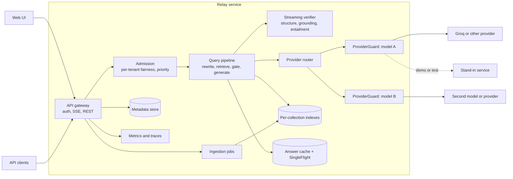

# The Relay

The Relay answers questions about your own PDFs, and every sentence it shows has been checked
against the passage it cites before you see it. It is built to keep working on a tight model
quota (such as Groq's free tier): it queues, caches, shares identical questions, and refuses
plainly when the documents do not contain the answer.

## Architecture



This is the target design ([docs/ARCHITECTURE_V2.md](docs/ARCHITECTURE_V2.md) §3). Not built
yet: query rewriting, entailment, the provider router and second lane, per-tenant fairness,
and metrics and traces. Today one lane (Groq or the stand-in) sits behind one ProviderGuard.

## How it works

- **Verified streaming:** the answer is split into sentences as it streams, and each sentence
  is checked against its cited passage before it is sent, so nothing unverified is shown.
- **SingleFlight and exact cache:** identical questions share one model call and repeats are
  served from the cache, so a 30-request burst was fully delivered with 6 model calls.
- **ProviderGuard:** every call reserves its tokens against the provider's per-minute and daily
  limits first, so under pressure requests wait, are refused early, or get passage pointers
  instead of failing.
- **Collection-aware safety:** the scope check, evidence gate and verifier use the names and
  passages of the collection's own documents, so an answer cannot cite another collection.

## Measured numbers

Burst of 30 requests in 2 seconds with the cache on, against the calibrated stand-in model.
V1 used the same requests, limits and stand-in (`evidence/experiments/exp-20261113T074759Z-c26f18c`).
V2 is `runs/v2-load-20261119T171412Z`. All five scenarios are compared in
[reports/phase-v2-14-load-revalidation.md](reports/phase-v2-14-load-revalidation.md).

| Metric | V1 | V2 |
| :-- | --: | --: |
| Requests delivered | 96.7 % | 100.0 % |
| Model calls made | 6 | 6 |
| Cache hits | 7 | 7 |
| Median total time | 614.2 ms | 498.8 ms |
| First verified sentence, median | n/a (answers were buffered) | 324.5 ms |

Under heavy overload with high partial rates, throughput is ~5pp lower than V1 due to
provider-side reservation costs for stopped streams (overload: 62.8 % delivered against 67.4 %).

## Quickstart

Needs Python 3.11+ and network access once, to fetch the three sample papers and the
embedding models. The web UI is already built in the repository, so Node.js is not needed to
run it.

```bash
git clone https://github.com/AyushSingh110/The-Relay
cd The-Relay
conda activate the-relay            # or: pip install -e ".[dev]"
cp relay.example.toml relay.toml    # Windows: copy relay.example.toml relay.toml

# One time: the sample papers, the embedding models and the sample collection's index
python scripts/ingest_papers.py
python scripts/build_indexes.py --download-models
python scripts/build_indexes.py

export RELAY_CACHE__MODE=sqlite     # collections and uploads need the metadata store
                                    # Windows PowerShell: $env:RELAY_CACHE__MODE = "sqlite"
relay serve                         # uses the stand-in model: no API key needed
# Open http://localhost:8000
```

To use Groq instead, replace the stand-in `[[lanes]]` block in `relay.toml` with the
commented Groq lane below it, then:

```bash
export GROQ_API_KEY=your_key_here
export MAX_REAL_CALLS=50            # hard cap on real calls for this process
relay serve
```

`relay doctor` checks the settings, files and key without printing the key.

## Upload a PDF and ask a question

1. On the Collections page, choose **New collection**, give it a name and create it.
2. Open **Add documents**, then drop a PDF on the page (or enter an exact arXiv ID such as
   `1706.03762v7`). Wait until it shows **Ready**.
3. Open the collection and ask about something the document discusses (for example "How does
   multi-head attention work?"). Verified sentences appear with citation chips; select a chip
   to see the passage it cites. A question the documents do not cover is refused.

The sample collection `v1-papers` (three arXiv papers) is ready as soon as the server starts.

## Run the tests

```bash
pytest                      # 757 backend tests, offline (no API key, no network)
ruff check .                # lint
cd web && npm ci && npm run build   # type-check and build the UI (Node.js 20+)
```

`relay ui build` rebuilds the UI and copies it into `src/relay/app/static/`.
`cd web && npm test` runs the UI tests.

## What is not built

- Fine-tuning of the model.
- Agents that take actions.
- Sources other than PDF (plain text and Markdown are planned; nothing else).
- Enterprise sign-in (SSO). Until V2-10, any API key is accepted for one development tenant.

More: the v2 design is in [docs/ARCHITECTURE_V2.md](docs/ARCHITECTURE_V2.md), the phase plan
in [docs/IMPLEMENTATION_PLAN_V2.md](docs/IMPLEMENTATION_PLAN_V2.md), and the v1 runbook
(probes, evidence, `results.csv`) in the README of tag `v1-submission`.
