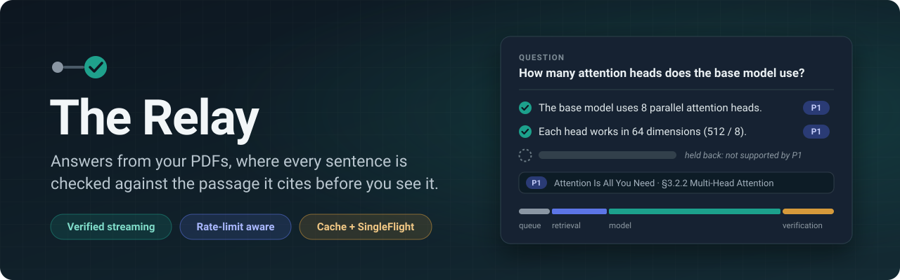

<p align="center">
  
</p>

<p align="center">
  <a href="https://github.com/AyushSingh110/The-Relay/actions/workflows/ci.yml"></a>
  
  
  
  
  
  <a href="LICENSE"></a>
</p>

**The Relay** answers questions from your own PDFs. It streams the answer one sentence at a time,
and **each sentence is checked against the passage it cites before it is sent**: a sentence that
fails the check is never shown. When the documents do not contain the answer, it says so.

It is built for a **tight model quota**, such as Groq's free tier: every call reserves its tokens
against the provider's limits first, identical questions in flight share one call, and repeats
come from the cache. You can try it all **without an API key**, using a stand-in model calibrated
from real Groq measurements.

<p align="center">
  <picture>
    <source media="(prefers-color-scheme: dark)" srcset="docs/assets/chat-dark.png">
    
  </picture>
</p>

**Contents:** [Features](#features) · [Measured results](#measured-results) ·
[Quickstart](#quickstart) · [How a question is answered](#how-a-question-is-answered) ·
[API](#api) · [Configuration](#configuration-and-commands) · [Development](#development) ·
[Project layout](#project-layout) · [Further reading](#further-reading) ·
[Contributing](#contributing) · [License](#license)

## Features

| Feature | Detail |
| :-- | :-- |
| **Sentence-level verification** | Structure (L1), grounding (L2) and refusal form (L3) are checked before each sentence is sent; entailment (L4) is scored in the background |
| **Quota-aware generation** | Every model call reserves its tokens against the provider's limits first; no hidden retries |
| **Burst handling** | 30 requests in 2 s: **30 of 30 delivered from 6 model calls** (17 joined a call in flight, 7 from the cache) |
| **Overload parity with v1** | **57.0 of 86** delivered against v1's 57.2 (5 runs each, within run-to-run noise), with the **first verified sentence 131 ms sooner** (489 against 620 ms, fast requests) |
| **Multiple workers** | With Redis, the cache, in-flight sharing and quota counters are shared: in the multi-worker tests, 10 identical requests to 2 workers make 1 model call |
| **Tested offline** | 1,040 backend tests with no API key, network or Redis server; 60 UI tests |

Load numbers are measured against the calibrated stand-in, not real Groq traffic. Bursts:
[runs/v2-load-20261119T171412Z](runs/v2-load-20261119T171412Z/comparison.md).

## Measured results

### How the overload gap was found and closed

Under sustained overload (86 requests over 236 s, v1's schedule and limits), the first v2 run
delivered 62.8 % against v1's 67.4 %. Repeated measurement traced the gap to three causes, none of
them the per-sentence check itself:

| Step | v1 `/ask` | v2 `/v1/ask` | What changed |
| :-- | :-- | :-- | :-- |
| First v2 run | 58 of 86 | 54 of 86 | 7 answers stopped mid-stream by the verifier |
| [F-02](runs/f02-overload-20261122T140530Z/): stand-in fixed, 5 runs each | 57.4 ± 0.5 | 55.6 ± 0.9 | The stand-in split sentences unlike the verifier: 0 stops now |
| [F-02b](runs/f02b-overload-l4off-20261122T150959Z/): profiling | | 56.2 ± 0.8 (L4 off) | Inline L4 cost ~130 ms per request; a lone tenant evicted its own requests |
| [F-02c](runs/f02c-overload-20261122T164234Z/): L4 async, work-conserving queue | **57.2 ± 0.4** | **57.0 ± 1.0** | Within run-to-run noise; first verified sentence 489 against 620 ms |

Streaming itself is cheap: in a one-at-a-time profile, splitting, checking, tracing and sending
events take about 10–15 ms per request. About 46 ms per request under load is still unattributed.

### When sentences really fail

In [F-07](runs/f07-summary-20261125T154240Z.md) the stand-in drops one citation in a set share of
answers (5 paired runs per rate). The v2 − v1 difference in delivered answers is −0.2, +0.2 and −0.8 at 0, ~1 and ~6 % bad
answers (each within noise), and −2.6 at ~27 % (per run −3, 0, −9, 0, −1), where cancelled
streams hold their quota. The stand-in holds the full reservation on a cancel; Groq held less.

### Real Groq: what happens to a cancelled stream

Measured with 10 real calls to `qwen/qwen3.8-27b`
([runs/f03-groq-refund-20261122T173322Z](runs/f03-groq-refund-20261122T173322Z/)):

- No refund appeared within about 1.6 s after a stream was aborted.
- Groq's token counter dropped by 217–355 per aborted call, between actual use (~46) and prompt
  plus maximum (443). Its headers are not an exact per-request ledger, so ProviderGuard trusts
  them for headroom instead of its own estimate.
- A request-rate limit that the headers do not show returned one 429 after 10 calls in ~2 s;
  `min_interval_ms` in `[guard]` now spaces call starts.

### The L4 judge on fixed test sets

With thresholds saved before scoring, it kept 39 of 40 supported quotes,
blocked 39 of 40 quotes paired with the wrong passage, and blocked 33 of 40 look-alike false claims,
34 of which pass the word-level checks. The 7 it missed are role or direction swaps, so it stays
advisory.

### Edge cases covered by tests

Another tenant never gets a cached answer (404 before any cache
lookup); a collection changed or deleted mid-answer ends cleanly and the old answer is not reused;
a key revoked mid-flight finishes its own answer, its follower still gets the verified answer,
and the key is refused (401) from then on.

The scripts behind every number are in [scripts/experiments/](scripts/experiments/).

## Quickstart

### Option 1: Docker Compose (no API key needed)

```bash
git clone https://github.com/AyushSingh110/The-Relay && cd The-Relay
docker compose up --build
```

Open **<http://localhost:8000>**. The first start downloads the three sample papers and the
models and builds their indexes (several minutes); everything is kept in `./data`, so later
starts take seconds. Services: `relay` (API and UI), `standin` (the calibrated stand-in model),
`redis` (shared state). Check it with `docker compose exec relay relay doctor`.

### Option 2: Local install (no Docker or Redis needed)

Needs Python 3.12 for the pinned versions (the package supports 3.11+; the Docker image uses 3.12
because the pinned numpy and PyMuPDF have no 3.11 builds). The UI is already built in.

```bash
python -m venv .venv && source .venv/bin/activate        # Windows: .venv\Scripts\activate
pip install -r requirements.txt && pip install --no-deps -e .
cp relay.example.toml relay.toml                         # Windows: copy ...
python scripts/ingest_papers.py                          # one time: the sample papers,
python scripts/build_indexes.py --download-models        #   the embedding models
python scripts/build_indexes.py                          #   and the indexes
export RELAY_CACHE__MODE=sqlite                          # PowerShell: $env:RELAY_CACHE__MODE = "sqlite"
relay serve                                              # then one command, from here on
```

<details>
<summary><b>Use Groq instead of the stand-in</b></summary>

Replace the stand-in `[[providers.lanes]]` block in `relay.toml` with the commented Groq lane
below it, then `export GROQ_API_KEY=...` and `export MAX_REAL_CALLS=50` (a hard cap on real calls
for the process) before `relay serve`. `relay doctor` checks settings, files, the key and the
state store without printing the key.
</details>

**Try it:** open the **v1-papers** collection and ask *"How does multi-head attention work?"*,
select a citation chip to read its passage, then ask something the papers do not cover: the
answer is a plain refusal. To use your own documents, create a collection and drop in a PDF.

## How a question is answered

1. **Admission:** authenticated, queued fairly per tenant (work-conserving: a lone tenant is
   first come, first served); a request that would miss its deadline is turned away at once.
2. **Cache and coalescing:** a repeat comes from the cache; an identical question in flight
   waits for that answer. Keys include the collection and its version.
3. **Retrieval and the evidence gate:** BM25 plus dense embeddings in the collection's index;
   weak evidence means a refusal with no model call.
4. **Guarded generation:** the provider router picks a lane; its ProviderGuard reserves tokens
   (and can space call starts, `min_interval_ms`) before the call.
5. **Verification:** each streamed sentence is checked before it is sent; L4 scores arrive in
   the final event (`[verifier] l4_mode = "async"`).

The full design is in [docs/ARCHITECTURE_V2.md](docs/ARCHITECTURE_V2.md); decisions in
[docs/DECISIONS.md](docs/DECISIONS.md).

## API

Every `/v1` route takes a Bearer key (`relay keys create --tenant T`); locally the development key
`relay-dev-key` is accepted.

```bash
curl -N http://localhost:8000/v1/ask -H "Authorization: Bearer relay-dev-key" \
  -H "Content-Type: application/json" \
  -d '{"question": "How many attention heads does the base Transformer use?", "collection_id": "v1-papers"}'
```

The answer streams as server-sent events: `accepted`, `status`, one `sentence` per verified
sentence, `sources`, and `final` (verdict, timings, tokens, cache status, L4 `confidences`).

| Method and path | Purpose |
| :-- | :-- |
| `POST /v1/ask` | Ask; streams verified sentences |
| `GET` / `POST /v1/collections`, `POST /v1/collections/{id}/documents` | Collections and uploads (PDF or exact arXiv id) |
| `POST /v1/conversations` | Follow-up questions |
| `GET /v1/requests/{id}` | A request's timing waterfall |
| `GET /healthz` · `GET /metrics` | Health with quota headroom · Prometheus metrics |
| `POST /ask` | The original v1 endpoint, unchanged |

## Configuration and commands

Settings come from `relay.toml` (start from [relay.example.toml](relay.example.toml), which
documents every option); any setting can be overridden with `RELAY_<SECTION>__<KEY>`.

| Command | What it does |
| :-- | :-- |
| `relay serve` | Start the API and the web UI |
| `relay doctor` | Check settings, files, keys and the state store (never prints secrets) |
| `relay keys create --tenant T` | Create an API key (stored hashed, shown once) |
| `relay eval run \| report \| gate` | Evaluation and the CI gate |

## Development

```bash
pip install -r requirements-dev.txt && pip install --no-deps -e .
pytest                       # 1,040 backend tests: offline, no API key, no Redis server
ruff check .
cd web && npm ci && npm test && npm run build      # 60 UI tests, type-check and build
```

## Project layout

| Path | Contents |
| :-- | :-- |
| `src/relay/` | The service: ingestion, retrieval, verifier, quota control, API, stand-in |
| `web/` | The React + TypeScript UI |
| `tests/` | The offline test suite |
| `scripts/` | Setup (ingest papers, build indexes) and v1 experiment scripts |
| `scripts/experiments/` | The scripts behind the measured results above |
| `runs/` | Raw data of every load run linked from this README |
| `evidence/`, `results.csv` | v1's recorded experiments (read-only) |
| `eval/` | Evaluation questions and the CI quality baseline |
| `docs/` | Architecture (`ARCHITECTURE_V2.md`) and the decision log (`DECISIONS.md`) |
| `docker/`, `Dockerfile`, `compose.yaml` | Packaging |

## Further reading

- [I Made My RAG Safer. It Got Worse Under Load.](https://dev.to/ayush_singh_9b0d83152be5b/i-made-my-rag-safer-it-got-worse-under-load-3olm)
  The original overload experiment.
- <!-- TODO(owner): replace with the published follow-up post URL --> *My Simulation Exaggerated
  the Cost of My Own Safety Feature*: the follow-up measurements, judge audit and corrections.

## Contributing

Issues and pull requests are welcome. See [CONTRIBUTING.md](CONTRIBUTING.md) for setup, the
checks to run and the project's rules, and [SECURITY.md](SECURITY.md) for reporting security
problems. Changes are listed in [CHANGELOG.md](CHANGELOG.md).

## Scope

Not built, by design: fine-tuning, agents that take actions, sources other than PDF, and
enterprise sign-in (access is by API keys, one or more per tenant).

## License

[MIT](LICENSE) © 2026 Ayush Singh
