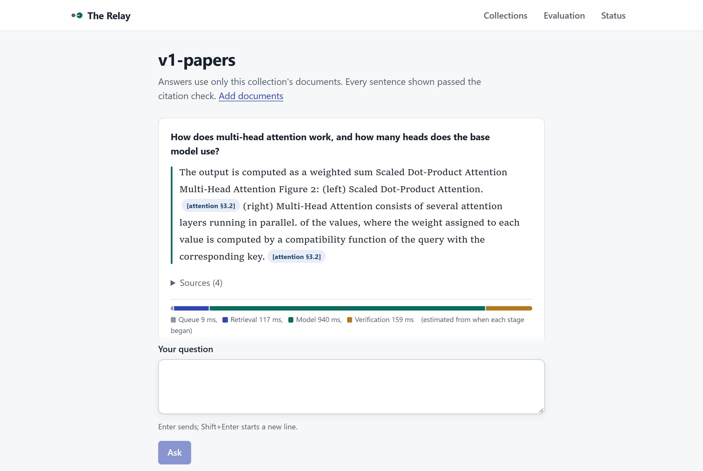
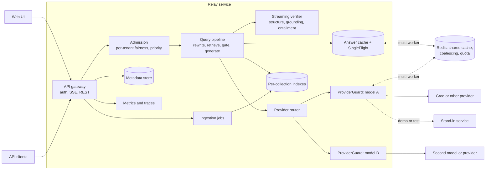

<p align="center">
  
</p>

<p align="center">
  <a href="https://github.com/AyushSingh110/The-Relay/actions/workflows/ci.yml"></a>
  
  
  
  
  
</p>

<p align="center">
  <a href="#quickstart">Quickstart</a> ·
  <a href="#features">Features</a> ·
  <a href="#how-a-question-is-answered">How it works</a> ·
  <a href="#measured-results">Results</a> ·
  <a href="#api">API</a> ·
  <a href="#configuration">Configuration</a> ·
  <a href="docs/ARCHITECTURE_V2.md">Architecture</a>
</p>

---

**The Relay** is a question-answering service for your own PDFs. It streams the answer one
sentence at a time, and **each sentence is checked against the passage it cites before it is
sent**: a sentence that fails the check is never shown. When the documents do not contain the
answer, it says so plainly instead of guessing.

It is built to keep working on a **tight model quota**, such as Groq's free tier. Every model
call reserves its tokens against the provider's per-minute and daily limits first, identical
questions share one call, and repeats come from the cache. Under pressure, requests wait or
are turned away early instead of failing halfway.

You can try all of it without an API key: a **stand-in model**, calibrated from real Groq
measurements, ships with the project.

<p align="center">
  <picture>
    <source media="(prefers-color-scheme: dark)" srcset="docs/assets/chat-dark.png">
    
  </picture>
  <br>
  <sub>The chat page, answering with the stand-in model. Each sentence carries the passage it cites; the bar shows where the time went.</sub>
</p>

## Quickstart

### With Docker Compose (the full stack)

Needs Docker, and network access once. No API key.

```bash
git clone https://github.com/AyushSingh110/The-Relay
cd The-Relay
docker compose up --build
```

Then open **<http://localhost:8000>**. The first start downloads the three sample papers and
the embedding models and builds their indexes, which takes several minutes; everything is
kept in `./data`, so later starts take seconds.

| Service | What it is |
| :-- | :-- |
| `relay` | The API and the web UI |
| `standin` | A stand-in model service, calibrated from real Groq measurements |
| `redis` | Shared state: the answer cache, coalescing and quota counters across workers |

Check the stack with `docker compose exec relay relay doctor`. The settings are in
[docker/relay.compose.toml](docker/relay.compose.toml). Port 8000 is published on this machine
only, because the development key is enabled for the bundled UI.

### Locally (one process, no Docker, no Redis)

Needs Python 3.12 for the pinned versions below (the package itself supports 3.11+). The web UI
is already built into the package, so Node.js is not needed to run it.

```bash
git clone https://github.com/AyushSingh110/The-Relay
cd The-Relay
python -m venv .venv && source .venv/bin/activate     # Windows: .venv\Scripts\activate
pip install -r requirements.txt && pip install --no-deps -e .
cp relay.example.toml relay.toml                      # Windows: copy relay.example.toml relay.toml

# One time: the sample papers, the embedding models and the sample collection's indexes
python scripts/ingest_papers.py
python scripts/build_indexes.py --download-models
python scripts/build_indexes.py

export RELAY_CACHE__MODE=sqlite       # Windows PowerShell: $env:RELAY_CACHE__MODE = "sqlite"
relay serve                           # the stand-in model: no API key needed
```

<details>
<summary><b>Use Groq instead of the stand-in</b></summary>

Replace the stand-in `[[providers.lanes]]` block in `relay.toml` with the commented Groq lane
below it, then:

```bash
export GROQ_API_KEY=your_key_here
export MAX_REAL_CALLS=50              # a hard cap on real calls for this process
relay serve
```

`relay doctor` checks the settings, files, key and state store without printing the key or
any password in the Redis URL.
</details>

### Try it

1. The sample collection **v1-papers** (three arXiv papers) is ready as soon as the server
   starts. Open it and ask, for example, *"How does multi-head attention work?"*
2. Select a citation chip to read the passage it cites.
3. Ask something the papers do not cover: the answer is a plain refusal.
4. To use your own documents, choose **New collection**, then **Add documents** and drop a
   PDF (or enter an exact arXiv ID such as `1706.03762v7`). Ask once it shows **Ready**.

## Features

| | |
| :-- | :-- |
| ✅ **Verified streaming** | The answer is split into sentences as it streams. Each one is checked for structure, grounding in its cited passage, and (optionally) entailment before it is sent. |
| 🚦 **Quota-aware provider guard** | Every call reserves its tokens against the provider's per-minute and daily limits. No hidden retries; a circuit breaker and a daily stop protect the quota. |
| ♻️ **Cache and SingleFlight** | Identical questions in flight share one model call, and repeats are served from an exact cache. |
| 🔀 **Provider router** | Several lanes (models or providers) with fallback, and one ledger of tokens and cost per call. Unpriced lanes report no cost rather than an invented one. |
| 👥 **Tenants and fair admission** | Hashed API keys, tenant isolation, and a fair queue so one noisy tenant cannot starve the others. |
| 📚 **Collections** | Upload PDFs into separate collections, each with its own index; answers can only cite their own collection. |
| 🧭 **Follow-up questions** | Conversations rewrite follow-ups ("and how many heads?") into standalone questions. |
| 📈 **Observability** | Prometheus metrics at `/metrics`, OpenTelemetry traces, and a per-request waterfall of queue, retrieval, model and verification time. |
| 🧪 **Evaluation and a CI gate** | An evaluation set, a review screen for grading answers, and a CI job that fails a change that stops answers being grounded. |
| 🧱 **Several workers (optional)** | With Redis, the cache, coalescing and every lane's limits are shared, so ten identical questions sent to two workers make one model call. |

## How a question is answered



1. **Admission.** The request is authenticated and queued fairly per tenant. A request that
   would wait past its deadline is turned away at once, with the reason.
2. **Cache and coalescing.** A repeat is answered from the cache; an identical question
   already in flight waits for that answer instead of making a second call.
3. **Retrieval and the evidence gate.** Hybrid retrieval (BM25 and dense embeddings) finds
   passages in the collection's own index. If the evidence is too weak, the answer is a
   refusal and no model call is made.
4. **Guarded generation.** The router picks a lane, and its guard reserves the tokens against
   the provider's limits before the call.
5. **Verification.** Each streamed sentence is checked against the passage it cites; only
   verified sentences reach you, with their citations.

Everything in the diagram is built. The full design is in
[docs/ARCHITECTURE_V2.md](docs/ARCHITECTURE_V2.md).

## Measured results

A burst of 30 requests in 2 seconds with the cache on, against the calibrated stand-in model.
V1 used the same requests, limits and stand-in (`evidence/experiments/exp-20261113T074759Z-c26f18c`).
V2 is `runs/v2-load-20261119T171412Z`.

| Metric | V1 | V2 |
| :-- | --: | --: |
| Requests delivered | 96.7 % | **100.0 %** |
| Model calls made | 6 | 6 |
| Cache hits | 7 | 7 |
| Median total time | 614.2 ms | **498.8 ms** |
| First verified sentence, median | n/a (answers were buffered) | **324.5 ms** |

Not every scenario improved. Under overload V2 delivers 62.8 % against V1's 67.4 %: an answer
stopped by the verifier keeps its token reservation at the provider. With the provider's
per-minute tokens halved, V2 delivers 72.5 % against 77.5 %, within run-to-run noise. All five
scenarios are compared in
[reports/phase-v2-14-load-revalidation.md](reports/phase-v2-14-load-revalidation.md).

## API

Every `/v1` route takes a Bearer API key (`relay keys create --tenant T`). On this machine, the
development key `relay-dev-key` is accepted by default.

```bash
curl -N http://localhost:8000/v1/ask \
  -H "Authorization: Bearer relay-dev-key" \
  -H "Content-Type: application/json" \
  -d '{"question": "How many attention heads does the base Transformer use?", "collection_id": "v1-papers"}'
```

The answer streams as server-sent events: `accepted`, `status` updates, one `sentence` event
per verified sentence, `sources`, and a `final` event with the verdict, timings, tokens and
cache status.

| Method and path | Purpose |
| :-- | :-- |
| `POST /v1/ask` | Ask a question; streams verified sentences (SSE) |
| `GET /v1/collections` · `POST /v1/collections` | List or create collections |
| `POST /v1/collections/{id}/documents` | Upload a PDF, or add an arXiv paper by ID |
| `POST /v1/conversations` | Start a conversation, for follow-up questions |
| `GET /v1/requests/{id}` | A request's timing waterfall |
| `GET /v1/eval/sets` | Evaluation sets, runs and grades |
| `GET /healthz` · `GET /metrics` | Health with quota headroom · Prometheus metrics |
| `POST /ask` | The original v1 endpoint, unchanged |

## Configuration

Settings come from `relay.toml` (start from [relay.example.toml](relay.example.toml), which
documents every option). Any setting can be overridden by an environment variable named
`RELAY_<SECTION>__<KEY>`, for example `RELAY_CACHE__MODE=sqlite` or
`RELAY_STATE__REDIS_URL=redis://redis:6379/0`.

| Section | Controls |
| :-- | :-- |
| `[[providers.lanes]]` | The models: stand-in or Groq, limits, prices, fallback order |
| `[guard]` · `[queue]` | Quota reservation and admission |
| `[auth]` | API keys and the development key |
| `[cache]` · `[state]` | Cache mode; memory (one process) or Redis (several workers) |
| `[retrieval]` · `[verifier]` · `[rewriter]` | Retrieval presets, verification layers, follow-up rewriting |
| `[ingestion]` · `[paths]` | Uploads and where data is kept |

### Command line

| Command | What it does |
| :-- | :-- |
| `relay serve` | Start the API and the web UI |
| `relay doctor` | Check settings, files, keys and the state store (never prints secrets) |
| `relay keys create --tenant T` | Create an API key (stored hashed, shown once); also `list`, `revoke` |
| `relay tenants` | Manage tenants |
| `relay eval import-v1 \| run \| report \| gate` | Evaluation and the CI gate |
| `relay ui build` | Rebuild the web UI into the package |

## Development

```bash
pip install -r requirements-dev.txt && pip install --no-deps -e .
pytest                  # 1,000+ backend tests: offline, no API key, no Redis server needed
ruff check .
cd web && npm ci && npm test && npm run build     # 60 UI tests, type-check and build
```

`requirements.txt` and `requirements-dev.txt` pin the exact versions the tests ran with; they
are generated by `python scripts/freeze_constraints.py` (along with the Docker image's
`docker/constraints.txt`). The accepted ranges are in `pyproject.toml`.

<details>
<summary><b>Project layout</b></summary>

```text
src/relay/
  api/            HTTP routes, auth, server-sent events
  app/            service composition, request log, the built web UI (static/)
  control/        admission queue, provider guard and router, shared state (memory or Redis)
  orchestrator/   the query pipeline, evidence gate, rewriter and streaming verifier
  providers/      Groq and stand-in clients
  retrieval/      BM25 and dense retrieval, indexes, embeddings
  ingestion/      PDF parsing and indexing jobs
  store/          the SQLite metadata store and its migrations
  telemetry/      metrics and tracing
  eval/           evaluation sets, runs and the CI gate
  standin/        the calibrated stand-in model service
web/              the React and TypeScript web UI
docker/           compose settings, entrypoint, pinned constraints
docs/             architecture, implementation plan, decisions
eval/             evaluation questions and the CI baseline
evidence/         v1 measurements: Groq probes, stand-in calibration, experiment runs
runs/             v2 load-test runs cited in the results above
```

</details>

## Scope

Not built, by design: fine-tuning, agents that take actions, sources other than PDF (plain
text and Markdown are planned), and enterprise sign-in (access is by API keys, one or more per
tenant).

## Documentation

- [docs/ARCHITECTURE_V2.md](docs/ARCHITECTURE_V2.md): the design
- [docs/IMPLEMENTATION_PLAN_V2.md](docs/IMPLEMENTATION_PLAN_V2.md): the phase plan
- [docs/DECISIONS.md](docs/DECISIONS.md): the decision log
- [reports/phase-v2-14-load-revalidation.md](reports/phase-v2-14-load-revalidation.md): the v1 and v2 load comparison
- The v1 runbook (probes, evidence, `results.csv`) is in the README of tag `v1-submission`.
