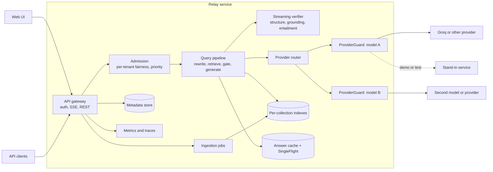

# The Relay v2 — Product Architecture

> **Status:** `APPROVED` by the owner on 2026-11-18 (see `docs/DECISIONS.md`). Implementation starts with V2-00 and V2-01.
> **Date:** 2026-11-17
> **Relation to v1:** v1 (`ARCHITECTURE.md`) is the submitted assignment system and stays frozen with its evidence. v2 turns it into a usable product and reuses most of v1's code.
> **Basis:** every "measured" figure below comes from the v1 evidence (`results.csv`, `evidence/`, `reports/phase-07`, `-10`, `-11`). Every target is a goal, not a measurement.

---

## 1. Product definition

**One line:** a self-hostable service that answers questions about *your own* document collections with sentence-level verified citations, and that stays usable when the model provider's rate limits are tight.

**Who it is for**

| User | What they need | What v1 gives them today |
| :-- | :-- | :-- |
| Researcher or engineer with a pile of PDFs | Trustworthy answers with page-level sources | Only three hard-coded papers |
| Small team on a free or cheap LLM tier | A service that degrades gracefully instead of failing at the quota | The control plane works, but nobody can run it |
| Developer building on top | A stable API with streaming and traces | One `POST /ask`, buffered, no auth |

**The two promises the product makes**

1. **No uncited sentence is ever shown.** Each sentence is checked against the passages it cites before the user sees it.
2. **The service bends, it does not break.** Under load or at a quota limit, a user is told where they are in the queue, is served a cached answer, or gets pointers to the relevant passages. They never get a silent hang or a raw provider error.

**Out of scope for v2:** fine-tuning, agents that take actions, non-PDF sources beyond plain text and Markdown, and enterprise SSO.

## 2. What v1 measured, and what it means for the design

| v1 measurement | Design consequence in v2 |
| :-- | :-- |
| Answers are buffered until verified, so first token equals total time: 0.7 s when idle, 23.4 s at p95 under overload | Stream status events immediately and release sentences as each one verifies (§6) |
| The slowest overload request spent 29.2 of 29.8 s waiting for token quota | Show queue position and expected wait; route to a second model when the wait is long (§7) |
| A 30-request burst needed 6 provider calls with cache and coalescing on; 96.7 % delivered against 26.7 % without | Keep SingleFlight and the exact cache as core, and make the cache persistent (§8) |
| With the provider's TPM halved, the guard throttled from headers with 0 provider 429s | Keep ProviderGuard unchanged as the per-model quota owner (§7) |
| gpt-oss spent all 512 completion tokens on reasoning in 3 of 6 comparison questions | Per-model token budgets, plus escalation on truncation (§7) |
| Reranking added about 1.26 s for a gain within noise on 15 questions | Default to no rerank; make rerank a per-collection setting (§5) |
| The verifier passed a refusal written as a cited sentence | Add refusal-form detection and an entailment layer (§6) |
| Correctness is 40–47 % by literal matching on 21 questions, unreviewed | Build an evaluation system that can be trusted before claiming quality (§10) |

## 3. System overview

One deployable service in three roles (API, ingestion worker, web UI), which run as one process by default and can be split later.

## 4. Decisions

Each decision names the alternative that was rejected and why.

| # | Decision | Rejected alternative | Why |
| :-- | :-- | :-- | :-- |
| D1 | **SQLite** (WAL mode) for metadata, behind a repository interface | Postgres from day one | One file, zero operations, enough for a single node. The interface keeps Postgres open for later. |
| D2 | **Keep the v1 hybrid index** (BM25 + dense, on disk per collection), loaded lazily with an LRU limit | A vector database now | v1 retrieval takes 35 ms at this scale. A `VectorStore` interface allows Qdrant or pgvector when one collection exceeds roughly 100k chunks. |
| D3 | **In-process ingestion queue** backed by a jobs table | Celery or a message broker | One worker loop is enough; the jobs table makes it restart-safe. |
| D4 | **Sentence-level verified streaming** | Keep full buffering; or stream raw tokens and retract | Buffering wastes the model's speed. Retraction breaks promise 1. |
| D5 | **Layered verifier**: v1 structural and literal checks, then an entailment model | An LLM judge per answer | A second LLM call doubles token cost on a tight quota. A small local model costs CPU only. |
| D6 | **Provider router over independent ProviderGuards** | One global guard | v1 evidence shows limits are per model. Independent lanes allow fallback. |
| D7 | **State interface** (`StateStore`) with an in-memory default and an optional Redis backend | Redis required | Single-node users should not need Redis. Multi-worker deployments opt in. |
| D8 | **API keys with per-tenant quotas** | No auth, or full user accounts | Keys are enough for a self-hosted product and make fairness possible. |
| D9 | **Semantic cache stays out of the default path** | Turn it on for hit rate | The v1 reason still holds: a near-duplicate match can serve a confidently wrong cited answer. It may return later as an experiment gated by the verifier. |
| D10 | **React + Vite web UI**, built to static files and served by the API | Server-rendered framework | No second runtime to deploy. |

**New dependencies this requires** (each needs owner approval, because `CLAUDE.md` currently forbids several): `aiosqlite` or `sqlite3` with a thread pool, `prometheus-client`, `opentelemetry-sdk`, `python-multipart`, an ONNX entailment model, Docker for packaging, and optionally `redis`. No LangChain, LlamaIndex or agent framework.

## 5. Data model and ingestion

**Entities** (SQLite tables):

- `tenant` — id, name, created.
- `api_key` — hash, tenant, role, limits.
- `collection` — id, tenant, name, retrieval settings, **version** (bumped on every document change).
- `document` — id, collection, source (upload or arXiv), SHA-256, title, pages, status.
- `chunk` — id, document, page range, section, text hash. The text lives in the index files.
- `ingest_job` — document, state, attempts, error class.
- `conversation`, `message` — for follow-up questions.
- `request_log` — one row per request, with the `results.csv` columns plus tenant and collection.
- `eval_set`, `eval_question`, `grade` — replaces the JSON files.

**Ingestion flow**

1. Upload a PDF, or submit an arXiv ID with an exact version.
2. Validate the file (size, page count, type) and store it under its SHA-256, so duplicates are detected.
3. A background job parses, chunks and embeds, reusing the v1 parser and chunker.
4. The collection's index is rebuilt incrementally, and the collection version is bumped.
5. The document status becomes `ready`. The UI polls or receives an event.

**Changes from v1:** the hard-coded three-paper list goes away. The scope analyser's paper cues and the verifier's paper-name checks are derived from each document's title and identifiers at ingestion time, per collection.

**Retrieval settings** move from three global presets to a per-collection setting, defaulting to `small_fast` (the cheapest preset, and within noise of the best on the v1 evaluation).

## 6. Query pipeline and verified streaming

**Pipeline steps**

1. **Resolve context.** For a follow-up, rewrite the question into a standalone one using the conversation. The first question of a conversation skips this.
2. **Scope analysis** (deterministic, from v1), now per collection.
3. **Retrieve** from the collection's index.
4. **Evidence gate** (from v1): sufficient, one re-query, or early refusal with no model call.
5. **Generate**, streaming, through the provider router.
6. **Verify each sentence as it completes** and release it.
7. **Finish:** final metadata, cache the answer if every sentence verified.

**Streaming protocol** (SSE events from `POST /v1/ask`):

| Event | When | Payload |
| :-- | :-- | :-- |
| `accepted` | Immediately | request id, queue position, expected wait |
| `status` | On each stage change | `queued`, `retrieving`, `generating`, `verifying` |
| `sources` | After retrieval | the passages that will be cited, with page numbers |
| `sentence` | When a sentence passes verification | text, citation tags |
| `stopped` | If a sentence fails | reason class; no unverified text |
| `final` | End | status, spans, tokens, cache status, verdict, `confidences` (L4, F-02c) |

**How verified streaming keeps promise 1.** The server holds back the sentence being generated. When the sentence ends, the verifier checks it. Only then is it sent. If it fails, generation is cancelled, the user keeps the verified sentences already shown, and the answer is marked partial. Nothing is ever retracted because nothing unverified is ever sent.

**Verifier layers**

| Layer | Check | Source |
| :-- | :-- | :-- |
| L1 structure | Every sentence has a valid passage tag; refusal marker is alone | v1 |
| L2 literal grounding | Numbers, identifiers, paper names and pages appear in the cited passage | v1 |
| L3 refusal form | A sentence that says "the passages do not state…" is treated as a refusal, not a claim | new; closes the v1 gap |
| L4 entailment | A small local model scores whether the cited passage supports the sentence | new |

L4 is advisory at first: it is logged and shown as a confidence mark, and it only blocks once its threshold has been calibrated on the evaluation set (§10).

**L4 off the critical path (F-02c, owner-approved 2026-11-22).** With `[verifier] l4_mode = "async"` (the default), a sentence that passed L1–L3 is sent at once; its L4 score is computed in the background, one model call at a time per process, after which the scores arrive in the `final` event's `confidences` (and the trace's `verifier.l4` spans). The scores are collected after the request's queue slot is released, so L4 never holds a slot. `"sync"` keeps the earlier behaviour (each sentence waits for its score); `"disabled"` never loads the model. Reason: under overload, inline L4 added about 130 ms to each request's slot time and cost about 0.6 answers per run (reports/phase-f02b-latency-profiling.md).

**Latency targets** (goals, to be measured in the load harness):
- `accepted` event within 200 ms.
- First verified sentence within 2.5 s at the median when the queue is empty.
- A status update at least every 5 s while a request waits.

## 7. Control plane

**Kept from v1 without redesign:** `ProviderGuard` (token reservation, header sync, daily stop, circuit breaker), the retry policy and retry budget, and the stand-in service.

**New: provider router.** A list of lanes, each a (provider, model) pair with its own guard, token budget and reasoning settings.

Routing rules, in order:
1. Use the collection's primary lane if its guard can admit the request within the wait budget.
2. Otherwise use the next lane that can.
3. If the answer is truncated or refused where the evidence gate said the evidence was sufficient, retry once on a stronger lane (escalation), within the retry budget.
4. If no lane can serve before the deadline, return the honest "unavailable" reply with passage pointers (v1 behaviour).

**New: fair admission.** v1's queue is first-come-first-served. v2 adds:
- a token bucket per tenant, so one tenant cannot use the whole quota;
- two priority classes, interactive and batch;
- capacity derived continuously from a moving average of measured tokens per answer, instead of a fixed input.

**Daily budget.** Unchanged in principle: stop at a safety fraction, keep serving cached answers, and say clearly why a new answer is unavailable.

## 8. Caching and coalescing

- **SingleFlight:** unchanged from v1.
- **Exact cache:** persistent (in the metadata store). The key adds the collection id and **collection version**, so adding a document invalidates stale answers automatically.
- **Admission to the cache:** only fully verified, non-degraded, non-partial answers.
- **Conversations:** only standalone (rewritten) questions are cache keys.

## 9. API surface

| Method and path | Purpose |
| :-- | :-- |
| `POST /v1/collections`, `GET /v1/collections` | Create and list collections |
| `POST /v1/collections/{id}/documents` | Upload a PDF or submit an arXiv ID |
| `GET /v1/documents/{id}` | Ingestion status |
| `POST /v1/ask` | Ask a question; SSE stream (§6) |
| `POST /v1/conversations`, `GET /v1/conversations/{id}` | Follow-up context |
| `GET /v1/requests/{id}` | The request's trace and time breakdown |
| `GET /healthz`, `GET /metrics` | Health and Prometheus metrics |
| `GET /v1/admin/quota` | Per-lane quota, queue depth, circuit state |

All `/v1` routes need an API key. v1's `POST /ask` stays available for the load harness.

## 10. Evaluation and quality

1. **Eval sets live in the store**, per collection, with the v1 schema (required facts, gold citations, forbidden claims, trap type).
2. **Three graders, reported separately:** the v1 rubric (literal), the entailment model, and the owner's review. Only reviewed grades are called "correct".
3. **Regression gate in CI:** the full pipeline runs against the stand-in on every change (plumbing), and a small budgeted real run compares against the last accepted baseline.
4. **Calibrating L4:** the entailment threshold is chosen from reviewed grades, and its false-block and false-pass rates are reported.
5. **Target before any public quality claim:** at least 100 reviewed questions across at least three collections.

## 11. Observability

- **Metrics:** request counts by status and error code, first-sentence and total latency histograms, queue depth, tokens by lane, cache and coalescing rates, verifier blocks by layer, quota headroom.
- **Traces:** OpenTelemetry spans that map onto v1's waiting, working and retrying spans.
- **Per-request breakdown:** returned in `final` and shown in the UI: queue, retrieval, model, verification.
- **Cost:** a pricing table per lane fills the `cost_usd` column that v1 left blank.
- **Error classes:** transport failures record a sanitised category (DNS, connect, TLS, read) instead of only the exception type. v1 could not attribute its one failed real call.

## 12. Security and privacy

- API keys are stored hashed; every query is checked against the caller's tenant.
- Uploads are size- and page-limited, and parsed in a worker thread with a timeout.
- **Prompt injection:** document text is data. The prompt marks passages as untrusted, and the verifier is the backstop, since an injected instruction cannot produce a sentence that passes grounding.
- v1's secret redaction stays on all logs and traces.
- A tenant can delete a collection, which removes its files, index, cache entries and logs.

## 13. Deployment

| Mode | What runs | For |
| :-- | :-- | :-- |
| Local | One process: API, ingestion loop, UI | Trying it out |
| Compose | API container, optional Redis, optional stand-in | Self-hosting |
| Demo | Compose with the stand-in as fallback lane | A public demo that survives the free quota |

Multi-worker operation needs the Redis `StateStore` for the cache, coalescing and quota counters, and is optional.

## 14. What is reused from v1

| v1 module | v2 use |
| :-- | :-- |
| `providers/` (HTTP client, SSE, headers, errors) | Unchanged |
| `control/provider_guard.py`, `retry.py` | Unchanged; one instance per lane |
| `control/admission.py` | Extended with tenants and priorities |
| `control/cache.py` | SingleFlight unchanged; cache gains a persistent backend |
| `ingestion/` parser and chunker | Generalised beyond three papers |
| `retrieval/` | Unchanged core; per-collection indexes |
| `orchestrator/` pipeline, gate, prompt | Extended for streaming and conversations |
| `orchestrator/verifier.py` | Becomes layers L1 and L2 |
| `standin/` | Unchanged; also the demo fallback |
| `experiments/` harness and tables | Unchanged; re-used to validate every v2 phase |
| `telemetry/` | Rows kept; store-backed request log added |

## 15. Risks

| Risk | Mitigation |
| :-- | :-- |
| Sentence-level verification produces many partial answers | Measure the partial rate in the harness before making it default; fall back to buffered mode per collection |
| The entailment model is slow or inaccurate on CPU | Advisory first; block only after calibration; make it optional |
| Free-tier throughput (about 5 answers per minute per model) makes a public demo feel slow | Multiple lanes, persistent cache, visible queue position, stand-in fallback |
| Generalising the parser to arbitrary PDFs breaks on scanned or unusual layouts | Report extraction quality per document; reject scans clearly |
| Scope creep | The MVP cut in the implementation plan |

## 16. Open decisions for the owner

1. Approve this architecture and the new dependencies (§4), and update `CLAUDE.md` accordingly.
2. The product name and whether the repository stays one repo.
3. The second model lane for fallback.
4. Whether L4 entailment is in the MVP or after it.
5. Whether Redis and multi-worker support are wanted at all.
